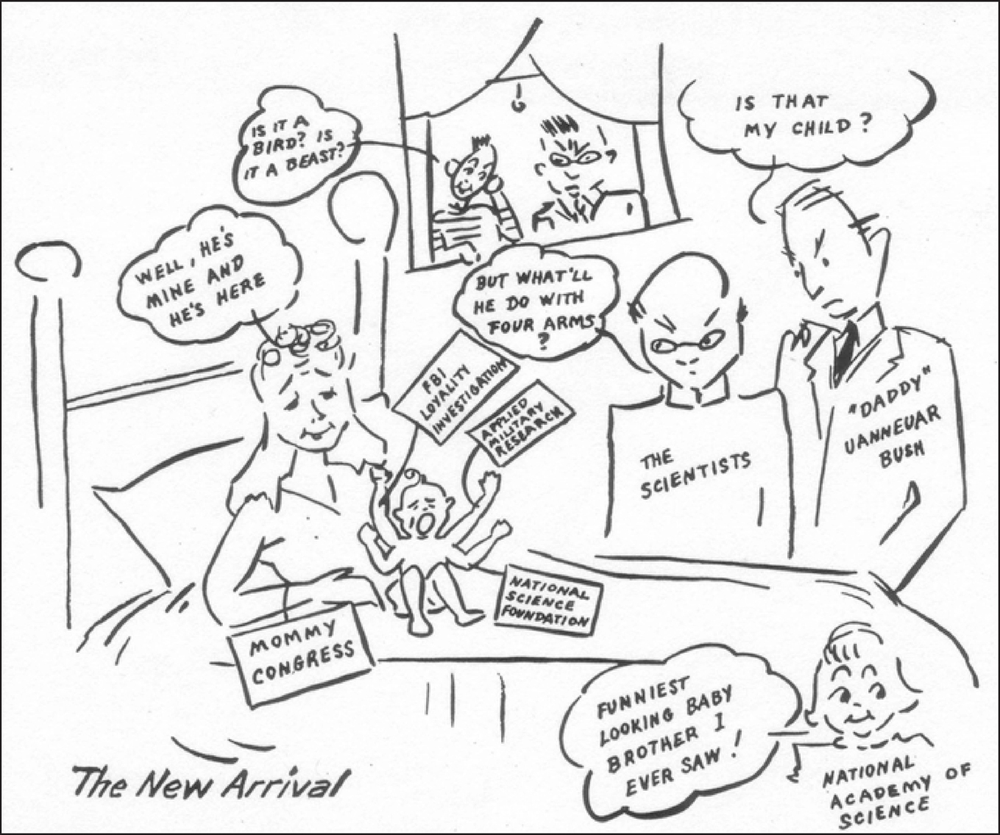

# 제12장 사회기술적 질서의 재구성

**버니바 부시와 미국 과학 정책 (Vannevar Bush and US Science Policy)**

*마이클 에런 데니스 (Michael Aaron Dennis)*

## 서론

1945년 7월, 전시 과학연구개발국(OSRD) 국장이었던 버니바 부시(Vannevar Bush)는 해리 S. 트루먼 대통령에게 『과학, 그 끝없는 프런티어(*Science: The Endless Frontier*, 이하 *SEF*)』라는 제목의 보고서를 제출했다. 오랫동안 미국 과학 정책의 기원으로 여겨져 온 이 보고서와 그 저자는 모두 미국 과학기술사에서 신화적인 존재다. 과학기술과 관련된 어떤 정부 문서도 이토록 부적(talisman)과 같은 절대적인 가치를 지니지 못했다. 이와 대조적으로, 원자폭탄 투하 이후 공개되었으며 전시 연구가 제기한 정치적 문제들에 대해 훨씬 더 냉철한 이해를 담고 있었던 헨리 스마이스(Henry Smyth)의 『군사적 목적을 위한 원자력(*Atomic Energy for Military Purposes*)』은 도서관과 중고 서점으로 자취를 감추었다.[^1] 50년이 지난 후에도 기자, 정치인, 과학 정책 분석가들은 마치 '부시 보고서'의 의미와 결과가 여전히 자명하고 중요한 것처럼 이야기한다. 고(故) 도널드 스토크스(Donald Stokes)가 지적했듯이, 문제의 일부는 이 보고서의 언어, 특히 '기초 연구(basic research)'라는 개념이 전후 과학 연구와 기술 개발의 조직을 효과적으로 식민지화하는 데 성공했다는 점에 있었다.[^2] 응용을 곧 타락과 동일시하는 암묵적 언어였던 순수 과학 및 응용 과학이라는 언어를 완전히 대체하지는 않으면서도 이를 보완한 부시의 보고서와 그 새로운 지적 분류 체계는, 물리 과학 및 생물의학 분야의 대학 연구에 대한 정부 자금 지원을 국가 안보와 장기적인 경제 성장을 위해 필수적인 것으로 만들었다.

그러나 이러한 언어적 성공에 상응하는 조직적 성과는 없었다. 1950년에 설립된 국립과학재단(NSF)은 부시가 구상했던 국립연구재단(National Research Foundation, NRF)과는 거의 닮지 않았다. 보고서상의 재단과 최종 수권 입법으로 탄생한 재단 사이의 차이는 전후 미국 연구개발(R&D) 조직을 둘러싼 투쟁에서 부시가 겪은 깊은 패배를 의미했다. 선구적인 논문에서 대니얼 J. 케블스(Daniel J. Kevles)는 부시 보고서를 과학과 사회의 관계에 대한 서로 다른 이해의 맥락 속에 위치시켰다.[^3] 케블스에게 부시의 재단은 연구 자금의 지리적 분배와 함께 사회적 책임을 다하는 과학을 계획했던 웨스트버지니아주 상원의원 할리 S. 킬고어(Harley S. Kilgore)의 구상에 대한 미국 과학 엘리트들의 대응이었다. 비과학자, 특히 정치인이 연구를 지시한다는 전망은 부시와 전시 행정 엘리트 구성원들에게는 끔찍한 혐오의 대상이었다. 네이선 라인골드(Nathan Reingold)를 비롯한 다른 학자들도 케블스의 '정치적 독해'의 주요 흐름을 따랐으며, 다만 어떤 세부 사항을 강조할 것인가를 두고는 이견이 남아 있다. 케블스와 다른 학자들에게 부시의 보고서가 강력한 과학 정책 문서였으며, 어떤 의미에서는 NSF 설립에 책임이 있고, 나아가 래리 오언스(Larry Owens)가 전후 시대 민-군 기술 관계를 위한 '헌법'이라고 부른 것이라는 점은 의심의 여지가 없었다.[^4] 확실히 이것은 부시 자신이 장려했던 관점이었으며, 특히 그의 가장 공인된 독자이자 과학 정책의 찰스강 학파(Charles River School) 창시자이며 『과학 계급(*The Scientific Estate*, 1965)』을 포함한 여러 영향력 있는 저작을 남긴 돈 프라이스(Don Price)의 연구에서 두드러졌다.[^5] 그러나 부시의 보고서를 과학 정책이라는 좁은 울타리(ghetto) 안에 가두는 것은 보고서 자체와 저자의 복잡한 동기를 모두 축소시키는 일이다. 우리는 부시를 과학 정책의 설계자로 읽기보다는, 자신이 실제로 살게 될 미래와는 사뭇 다른 미래를 향해 국가라는 배의 키를 적극적으로 돌리려 했던 미국 정치의 설계자로 읽어야 한다.

NSF와 관련하여 부시의 친자 관계(창시자로서의 지위)에 의문을 제기하는 것은 새로운 일이 아니다. 1950년 4월 자 『화학 및 공학 뉴스(*Chemical and Engineering News*)』에 실린 만평인 그림 12.1을 살펴보자. 팔이 네 개 달린 사생아인 '과학(Science)'에게는 당당하다 못해 반항적인 어머니인 '의회 엄마(Mommy Congress)'가 있다. 부시는 "이게 내 아이인가?"라는 유명한 질문을 던지는 모습으로 그려져 있다. 일반적인 과학자들과 여동생(국립과학원, NAS) 외에도 두 명의 엿보는 사람이 있다. '평범한' 시민일 수 있는 한 사람은 이 돌연변이 자식이 새인지 짐승인지 결정하지 못하고 있으며, 다른 한 사람은 침묵 속에서 지켜보는 사악해 보이는 자다. 아마도 그는 과학자들의 비밀을 훔쳐 가려고 기다리는 적국의 스파이였을 것이다. 이 이미지에 대한 우리의 관심은 두 가지다. 첫째, 당대인들이 부시가 국립과학재단(NSF) 설립의 장본인이라는 점에 확신하지 못했음을 분명히 보여준다. 둘째, 이러한 주장은 다른 질문을 가능하게 한다. 만약 부시가 그 유명한 보고서에서 NSF를 설립하려던 것이 아니었다면, 그는 대체 무엇을 하고 있었던 것일까?

*그림 12.1 새로 태어난 아기 (출처: Chemical and Engineering News)*

## 어떤 대가를 치르고 국가를 유지할 것인가?

하버드 대학교 총장이자 동료 전시 연구 행정가였던 제임스 브라이언트 코넌트(James Bryant Conant)에게 보낸 편지에서, 부시는 문제들이 *SEF*에서 논의된 쟁점들보다 훨씬 더 중대하다고 설명했다.

> 이 거시적인 질문은 우리가 프랑스의 길로 가고 있는가, 아니면 차라리 호주나 뉴질랜드의 길로 가고 있는가 하는 것입니다. 프랑스와의 유사성도 정확하지 않고 호주나 뉴질랜드와의 유사성도 정확하지 않지만, 분명 공통된 특징과 어떤 공통된 추세가 존재합니다.
>
> 저는 기습을 당하지만 않는다면, 일시적으로 엄격한 통제로 무장한 민주주의가 현대전을 치르는 가장 효과적인 방법이라는 제 믿음을 진술할 수 있으며, 실제로 이미 진술한 바 있습니다. 하지만 이것이 완전히 사실이 되려면 그 민주주의가 건전해야(sound) 합니다. 프랑스는 건전하지 못했습니다. 위대한 군대가 있었고 국민들의 용맹함도 의심할 여지가 없었으며 군사 기술이 뒤처지긴 했지만, 더 중요한 것은 민주주의가 끔찍한 혼란에 빠졌고 바로 그 목적을 위해 외부에서 작동시킨 분열 세력에 의해 내부로부터 잠식되었기 때문에 순식간에 무너져 내렸다는 점입니다.[^6]

건전성이 핵심 문제였다. 즉, 미국 민주주의는 소련과의 다가올 장기전을 견뎌낼 능력이 있는가? 부시는 이어서 이 점을 더욱 명확하게 밝혔다.

> 제 마음속의 가장 큰 질문은 이 나라가 그와 비슷한 길로 가고 있는가 하는 것입니다. 그렇다는 징후가 아주 많습니다… 어쩌면 그럴지도 모릅니다. 90년대(1890년대)에 이 나라의 거대한 산업 결합체들이 미국 정부를 장악하고 일종의 과두제를 영구화할 뻔했을 때, 우리는 마침내 분연히 일어섰고 그 문제는 꽤 결정적으로 해결되었습니다. 그러나 오늘날 우리는 노동 정부를 가지고 있으며 지난 12년 동안 그러했습니다. 그리고 우리가 독자적인 정당을 통해서가 아니라 그중 일부는 교활하기 짝이 없는 다양한 형태를 통해 행사되는 노동 세력의 통제하에 계속 나아가지 않을지 상당한 의문이 듭니다. 압력 단체가 무엇이든 간에 그들의 활동에 의한 통치는 불가피할지 모르지만, 그것이 제대로 작동하려면 핵심을 꿰뚫어 보고 균형을 유지하며, 정부를 그 순간에 우위를 점한 집단의 단순한 도구나 부속물 이상의 위치에 유지시키는 충분한 규모의 시민 집단이 있어야만 합니다. 제 관점에는 반(反)노동적인 것이 전혀 없지만, 즉시 그렇게 해석될 것입니다. 만약 제가 한 세대 전에 논쟁을 벌이고 있었다면 똑같은 의미에서 완전히 반(反)자본적이었을 것입니다.[^7]

여기서 우리가 파헤쳐 볼 만한 내용이 많지만, 우리의 연구와 관련된 맥락을 분명히 해두자. 우리는 부시가 *SEF*에서 무엇을 하고 있었는지 이해하는 데 관심이 있다. 전시 업무에 대한 OSRD의 대통령 최종 보고서 초안을 작성하던 중에 쓰인 이 편지는 국가의 미래에 대한 부시의 두려움을 표현하고 있었으며, 우리가 정의하는 좁은 의미의 과학 정책에 국한되지 않았다. 대신 부시는 과학을 더 큰 문제, 즉 전후 미국 국가의 본질이라는 문제의 일부로 개념화했다.

부시는 *SEF*에서 이 책의 핵심 주제인 공동생산(co-production), 즉 기술적 질서와 사회적 질서의 동시적 생산 문제를 제기한다. 이 편지가 분명히 보여주는 것은 부시에게 있어 정치, 과학, 그리고 사회 질서가 서로 긴밀하게 연결되어 있었다는 점이다. 이론적이거나 학술적인 차원을 떠나, 부시는 전후 미국 국가의 건전성을 극도로 시급하고 중대한 이해관계가 걸린 문제로 보았다. 그만이 그런 것은 아니었다. 추축국을 물리치는 데 전시 동맹이 성공했음에도 불구하고, 소련은 미국의 다음번 거대한 위협으로 지평선 위에 어른거리고 있었다. 생존의 문제는 워싱턴 정책 입안자들의 머릿속을 가득 채우고 있었으며, 이 문제의 핵심은 국가 정체성의 문제였다. 소련과의 길고도 어두운 투쟁의 전망은 미국을 자신이 물리치려 하는 바로 그런 종류의 국가로 변모시킬 것인가? 혹은 미국의 정치학자 해럴드 라스웰(Harold Lasswell)이 만든 용어를 빌리자면, 미국은 더욱 강력한 군수품의 원천으로서 과학기술과 결합한 군부가 국내의 지배적 권력이 되는 정치적 실체인 '병영 국가(garrison state)'가 될 것인가? 소련에 맞서는 과정에서 미국은 자국의 헌법에 새겨진 국가의 모습보다 자신의 적과 더 닮아가게 되지는 않을까?[^8] 부시의 편지는 그가 바로 그러한 불쾌한 방향으로 국가가 변모하는 것을 두려워했음을 분명히 보여준다.

코넌트에게 보낸 부시의 편지는 또한 과학사의 근본적인 문제, 즉 과학과 민주주의의 관계 문제를 제기한다. 과학기술학(STS) 연구자들에게 로버트 K. 머튼(Robert K. Merton)의 1942년 에세이 「과학의 규범적 구조(The normative structure of science)」는 이 문제의 가장 전형적인 고전(*locus classicus*)이다. 데이비드 홀린저(David Hollinger)가 설득력 있게 주장했듯이, 머튼의 에세이는 제1차 세계대전 이후 등장한 적수들, 특히 다양한 형태의 파시즘과 소련 공산주의에 맞서 민주주의를 수호하려는 더 넓은 문화적 프로젝트의 일부였다.[^9] 우리는 머튼이 논의한 문제를 쉽게 일축해 버릴 수도 있다. 냉전은 과학이 다양한 정치 체제 아래에서 번성할 수 있음을, 즉 정치적 충성심이 과학적 국제주의를 압도했음을 보여주었기 때문이다. 그러나 우리는 과학기술에 대한 개념들이 정치 영역에서 어떻게 문제로 작동했는지를 이해할 필요가 있다. 즉, 과학과 민주주의의 문제를 세미나실에서 꺼내어 행위자들의 텍스트가 실질적인 정치 행동의 도구로 쓰이는 영역으로 옮겨와야 한다. 예를 들어, 국가자원계획위원회(NRPB) 위원장이었던 프레더릭 델러노(Frederic Delano)는 1940년 8월에 미국이 "군사적 전멸과 지구상에서 민주적 제도의 말살이라는 오만한 위협"에 직면해 있지만, "현대 삶에서 가장 혁명적인 요인"은 "나치즘이나 파시즘"이 아니라 "과학, 발명, 기술의 전례 없는 성장"이라고 설명했다.[^10] 무슨 일이 일어나든, "민주적이든 전제적이든 오래된 목적을 달성하기 위한 새로운 수단들이 등장하고" 있었다. 우리는 델러노의 텍스트를 과학기술이 새로움의 원천으로 기능하고 정치인들은 그에 반응할 뿐이라는 기술결정론의 또 다른 사례로 치부할 수도 있겠지만, 그러한 독해는 "민주주의의 오래된 가정들은 여전히 유효하지만, 그 프로그램과 실천은 새로운 세계에 맞게 조정되어야 한다"는 그의 통찰을 무시하는 것이 된다. 부시와 델러노 같은 사람들에게 과학기술은 정치의 문제였다. 우리는 우리 학문 분야의 역사적 저작들을 읽는 것과 똑같은 방식으로 그들의 실용적인 텍스트를 읽고 이해해야 한다. 머튼과 그의 제자들 및 수많은 추종자들에게 문제는 언제나 정치가 과학에 제기하는 문제들이었다. 반면 델러노, 라스웰, 부시에게 초점은 점점 더 기술적 지식과 그 생산자들이 기존의 정치 질서에 제기하는 문제들로 맞춰졌다. 더 직설적으로 말하자면, 문제는 사회 속의 과학자들이었지, 과학 속의 사회나 정치가 아니었다.

1945년 봄과 초여름에 작성된 *SEF*는 부시와 다른 이들이 직면한 핵심적인 정치적 문제, 즉 전후 미국 국가에서 미군이 어떤 역할을 할 것이며 미국의 과학자들과 엔지니어들은 이 새로운 정치적 지형 속에서 어떻게 역할을 수행할 것인가 하는 문제를 다루었다. 특히 *SEF*는 군부가 과학을 지배하는 것을 막는 동시에 연구자들을 강력한 기술에 대한 스스로의 열광으로부터 격리시키기 위해 과학에 대한 연방 정부의 후원을 조직화하고자 했다. 이 정치적 문제에 대한 부시의 해결책은 '기초 연구'라는 새로운 유형의 지식을 창출하고, 동시에 과학에 대한 공적 지원을 위한 새로운 제도적 메커니즘인 국립연구재단(NRF)을 구축하는 것이었다. 기초 연구와 NRF의 공동생산은 권력과 부를 모두 얻기 위해 과학기술의 산물에 의존하는 새로운 종류의 국가를 낳았다. 이러한 주장을 뒷받침하기 위해서는 과학과 제2차 세계대전에 관한 이야기를 다시 쓸 필요가 있다.

이어지는 내용에서 나는 부시와 다른 기술 지식의 생산자 및 소비자들이 직면하고 해결했던 실질적인 정치적 문제들의 관점에서 전시 과학의 역사를 재검토한다. 전간기(제1·2차 세계대전 사이) 동안 부시와 당대인들에게 열려 있었던 가능성의 지평을 다시 살펴본 후, 전쟁을 위한 과학의 조직화와 전쟁 중 과학의 관리 문제를 다시 들여다본다. 비록 부시가 전시 연구의 조직화를 둘러싼 전투에서는 승리했지만, 그가 내린 다른 판단들, 특히 전시 연구 기관들의 일시적 성격에 대한 그의 확신은 전후 연구개발 조직화에서 그가 수행할 역할을 심각하게 제한했다. 세 가지 전시 문제가 부시로 하여금 전후의 우려 사항들을 다루도록 강제했다. 첫째, OSRD 연구소에서 개발된 신무기의 생산 및 사용과 관련된 문제들, 둘째, 독일의 순항 미사일 및 탄도 미사일에 대한 미군의 매혹, 셋째, 전후 연구 조직화를 위한 군부의 인상적이고도 집요한 계획 수립이었다. 이 마지막 점의 핵심에는 전쟁이 낳은 가장 거대한 예기치 못한 결과 중 하나, 즉 미국 연구자들에게 미친 무기 기술의 매혹적인 힘이 자리 잡고 있었다. 부시가 *SEF*를 작성한 것은 바로 이처럼 복잡한 정치적 맥락 속에서였으며, 부시의 비전이 패배하게 될 곳도 바로 이 무대였다. 이 장에서의 공동생산은 공학적 실패의 이야기이자, 새로운 형태의 지식과 그 확립 및 사용을 위한 메커니즘을 성공적으로 정의하고 방어하지 못한 무능력의 이야기다. 아마도 가장 가슴 아픈 점은 부시 자신이 스스로 무엇을 잃었는지 정확히 깨달았다는 사실일 것이다.

## 시간이 잊은 땅 (전간기의 상황)

버니바 부시는 미국 최초의 민간 연구 기관 중 하나인 워싱턴 카네기 협회(CIW)의 신임 원장이자 국가항공자문위원회(NACA)의 신임 위원장 자격으로 1939년 초 워싱턴 D.C.에 도착했다.[^11] 부시는 친구인 칼 T. 콤프턴(Karl T. Compton)이 MIT 총장으로 재직하는 동안에는 얻을 수 없었던 행정적 도전을 추구하기 위해 부분적으로 MIT 공과대학 학장 및 전기공학과 교수직을 떠났다. 부시는 전간기 과학의 정치경제학이 낳은 인물이었다. 그는 MIT 연구 지원을 위해 산업계 및 민간 자선 재단 모두와 성공적으로 협상을 벌여왔으나, 래리 오언스가 보여주었듯이 정부와 대학 모두에 이익이 될 수 있는 기술 조사를 지원하기 위해 연방 정부와 MIT 사이의 관계를 구축하는 데는 대체로 실패했다. 부시의 감수성은 연방 정부가 대학 연구에서 거의 아무런 역할도 하지 않던 시기에 형성되었다. 대학 기반 연구자들이 단명한 과학자문위원회(SAB)와 같은 다양한 노력을 기울였음에도 불구하고, 전국 농업시험장에서 수행되는 연구를 제외하고는 대학이 연방 자금으로 연구비를 조달할 방법을 찾는 것이 불가능하지는 않더라도 매우 어렵다는 사실이 입증되었다.[^12] 우리는 대학의 구조가 바뀌어야 하는지 아니면 국가의 구조가 바뀌어야 하는지를 둘러싼 논쟁의 축을 따라 이 문제를 다음 표(표 12.1)와 같이 요약할 수 있다.

**표 12.1 1930년대에 가능했던 대학-정부 관계**

| | **국가 구조 (State Structure)** | |
| :--- | :--- | :--- |
| ***대학 구조 (University Structure)*** | 둘 다 변화 | 국가는 변화, 대학은 불변 [NRPB] |
| | 대학은 변화, 국가는 불변 [SAB] | 둘 다 불변 [OSRD] |

전간기의 연구자들과 정부 관리들은 연구에 대한 연방 자금 지원을 제도화하기 위한 제한된 범위의 모델만을 가지고 있었다. 미국 과학계 구성원들에게는 실패로 끝난 과학자문위원회(SAB)가 선택된 메커니즘이었다. 칼 T. 콤프턴의 리더십 아래 록펠러 재단이 비용을 대고 국립과학원(NAS) 내부에 자리 잡은 이 2년간의 실험은, 루스벨트 행정부가 정부의 관심 분야에서 대학 연구를 후원하도록 흥미를 유발할 만한 의제를 만들어내려 시도했다. 콤프턴, 부시 및 다른 물리학자들은 대학이 국가의 경제 위기를 해결하는 데 있어 입법부를 돕기 위해 학제간 연구 센터를 설립할 의지가 있고 또 그럴 수 있다고 믿었다. 과학자문위원회는 1930년대의 위기가 학문적 경계를 초월하는 특정한 기술적 문제들을 중심으로 대학을 재구조화할 것을 요구한다는 믿음 아래 운영되었다. 반면 미국 국가의 구조와 성격은 바뀔 필요가 없었다. 대학 연구에 대한 연방 정부의 후원을 끌어내려는 또 다른 주요 시도였던 국가자원계획위원회(NRPB)에서는 대학-정부 관계에 대한 매우 다른 관점이 작동했다. 미국 대통령(프랭클린 루스벨트)이 가장 아끼는 삼촌이었던 프레더릭 델러노의 지휘 아래 내무부 장관 해럴드 이키스(Harold Ickes) 산하의 일부로 설립된 NRPB는, 과학적 전문성을 추가함으로써 행정부의 권한 확대를 정당화하기 위해 대학의 기존 학문 분과 구조를 활용하고자 했다. 전통적인 대학 구조가 행정적 팽창과 혁신을 정당화해 줄 것이었다. NRPB가 미국 사회과학자들의 총아였다는 사실은 사회과학을 루스벨트 행정부의 학술 조직으로 보았던 부시와 콤프턴 같은 자연과학자 및 엔지니어들의 불안감을 더욱 증폭시킬 뿐이었다. 앞으로 이어질 내용과 관련하여 중요한 점은, 심지어 부시를 포함한 그 어떤 참여자도 대학과 국가의 구조가 모두 변하는 일련의 상황을 상상할 수 없었다는 사실이다.

## 전쟁이 일어날 경우…

전쟁을 위해 미국 과학을 조직화하는 데 있어 버니바 부시가 수행한 역할은 전설적이지만, 그 이야기는 부시가 몇 안 되는 자신의 관료적 승리 중 하나에서 물리쳤던 경쟁자들뿐만 아니라 그 과제가 제기했던 난관들을 생략하고 있다. '가짜 전쟁(phony war)'이 실제 폭발적인 전투로 번지던 1940년 5월, 유명한 우주선(cosmic ray) 물리학자인 아서 홀리 콤프턴(Arthur Holly Compton)은 부시를 신임 해군 장관으로 추천하면서 특유의 간결한 전보문체로 다음과 같이 설명했다.

> 입증된 신무기의 위력은 국가 방위가 과학 기술의 응용에 익숙한 인물들에 의해 지휘되어야 함을 필수적으로 만듦. 따라서 군사적 전통에 얽매인 인물보다는 버니바 부시 같은 인물을 해군 장관이라는 핵심 직책에 임명할 것을 촉구함. 군사 문제에 기술 인력과 시설을 신속하고 효과적으로 집중시키는 것이 국가 방위에 필수적임.[^13]

콤프턴의 메시지는 새로운 전쟁의 시급성과 참신성을 포착했다. 그것은 부시가 이미 1939년 4월에 허버트 후버(Herbert Hoover) 전 대통령에게 "항공기에 의한 폭격에 맞서는 효과적인 방어책이 있다면 전 세계의 상황이 크게 달라질 것"이라고 설명하면서 과학의 역할을 분명히 제시했던 전쟁이었다.[^14] 부시는 스탠퍼드와 MIT 양쪽에서 항공기를 탐지하기 위해 전파를 사용하는 연구를 카네기 협회가 어떻게 지원할 수 있을지에 대한 조언을 구하기 위해 후버에게 편지를 썼다. 이는 부시가 MIT에서의 인맥뿐만 아니라 국립과학원과 NACA에서의 새로운 워싱턴 인맥을 통해 습득한 지식이었다. 부시가 해리 홉킨스(Harry Hopkins)와 델러노와의 접촉을 통해 프랭클린 D. 루스벨트(FDR)에게 접근하여 1940년 6월 국방연구위원회(NDRC)를 설립할 수 있었던 것은 바로 이러한 개인적이고 비공식적인 지식 덕분이었다.[^15] 그러나 부시가 이 새로운 조직에 가져온 강점들은 잠재적인 약점이기도 했다.

새로운 조직에 대한 도전자들이 빠르게 나타났다. 1940년 8월, 해럴드 이키스 내무부 장관은 독특한 지식사회학을 통해 미국 과학을 조정할 과학연락국(Office of Scientific Liaison) 설립 계획을 가지고 FDR에게 접근했다. 최첨단 지식이 연구자들의 머릿속과 파일 캐비닛 속에 손대지 않은 채로 잠자고 있다고 주장하면서, 이키스는 미국의 과학자들이 그들의 파일 캐비닛을 워싱턴 D.C.로 보내도록 하고, 그곳에서 실직 과학자들과 대학원생들이 유용한 발명과 발견을 찾아 파일들을 발굴하게 하자고 FDR에게 촉구했다. 이키스에게 이러한 접근 방식은 정부 연구 노력의 규모와 범위를 엄청나게 증가시킬 것이었다. 이키스는 NDRC가 추가되었음에도 불구하고 불과 500~600명의 연구자만이 정부에 자문을 제공하고 있으며, 나머지 99,500명은 전쟁 노력에 참여할 방법이 없는 상태로 남겨져 있다고 주장했다.[^16] 상설 내각 부처 내에 자리 잡고 실제로 가동되는 과학연락국은 내무부에 완전히 새로운 의미를 부여할 것이었다. 이키스의 계획은 부시의 사무실로 흘러 들어갔다. FDR은 이키스에게 "'과학'이라는 일반적이고 광범위한 분야와 연방 정부의 단일 기관이 직접적이고 완전한 연락을 유지하는 데는 심각한 한계가" 있기 때문에 기존의 방식이 다가올 분쟁에 만족스럽다고 설명했다.[^17] 이후 1941년 8월, 이키스는 전시 과학의 통제권을 장악하기 위해 또 한 번의 포문을 열었으나 다시 한번 패배했을 뿐이었다.

부시의 새로운 기관은 또한 군부 내에서도 두려움을 불러일으켰다.[^18] 해군연구소(NRL) 소장이자 부시의 열렬한 비판자였던 해럴드 보언(Harold Bowen)은 NDRC의 설립을 환영하면서도, 상관들에게 "현재의 비상사태"가 끝나면 NDRC가 "육군과 해군의 연구 활동을 *보완(supplement)*하는 대신 *대체(supplant)*하게" 될 것이라고 경고했다.[^19] NRL이 레이더라는 동일한 기술에 지금껏 지출한 모든 비용보다 더 많은 자금을 부시가 레이더 개발을 위해 모금한 것에 질투를 느낀 보언은 NDRC에서 단 하나의 잠재적 이점만을 보았다. 즉, 전쟁이 끝나면 군이 상당한 규모의 연구 프로그램들을 인수하게 될 것이라는 점이었다. 그러한 일은 부시 조직의 일시적 성격 때문에 일어날 것이었는데, 이는 부시와 보언 모두가 비록 전혀 다른 이유에서였지만 중요하게 여겼던 특징이었다.

전시 연구 기관인 NDRC와 1941년 7월 이후의 과학연구개발국(OSRD)이 지닌 한시적 지위는 부시의 초기 관료적 성공에 있어 결정적인 특징이었다. 부시에 따르면, 전시 기관들은 비상사태 기간 동안에만 존재하고 그 후에는 해체될 예정이었다. 따라서 OSRD는 새로운 상설 연구소를 만들지 않고 연구개발을 위해 대학들과 계약을 맺을 것이었다.[^20] 재협상이 가능한 유한한 기간이라는 장점을 지닌 계약 조건들은 새로운 기관의 간접비(overhead) 정책에 명확히 표현된 특정한 정치적 관점을 구현했다. 1940년 당시 간접비는 아직 미국 연구 중심 대학의 생명줄이 되지 않았던 때였다. 대신 대학 행정가들은 전시 연구 지도자들과 마찬가지로 자신들이 비상사태를 이용해 사리사욕을 채우는 것으로 비춰지지 않기를 염려했다. 그러한 인상을 피하기 위해 NDRC와 OSRD는 "모든 점을 고려할 때 교육 기관은 이득을 취하는 자가 되어서는 안 되며, 현재의 예산 손실 없이 기여할 수 있는 시설의 일부를 연구에 기여해야 한다"는 정책을 채택했다.[^21] 흔히 '무이득-무손실(no-gain-no-loss)' 또는 '무수익-무손실(no-profit-no-loss)'로 축약되는 이 계약 방식은 OSRD의 한시적 성격과 결합하여 과학의 정치경제학에 대한 전시 행정가들의 이해의 핵심을 찔렀다. 앞의 표로 돌아가자면, 부시는 원래 미국이 시간적 거품(temporal bubble) 속에서 전쟁을 치르고 조직을 운영할 수 있다고 믿었다. 전쟁이 끝나면 거품은 꺼지고 전쟁 전의 제도적 배치가 다시 제자리로 돌아올 것이었다. 새로운 조직들은 한쪽으로는 대학 기반의 연구 시설들, 다른 한쪽으로는 대학 연구소에서 개발된 무기를 제작할 기업들, 그리고 새로운 기술에 비용을 지불하고 이를 사용할 군대에 의해 둘러싸인 사회적 공간에 존재할 것이었다. 만약 전시 조직들이 비상사태 기간 동안만 존재하고 그 이상은 존재하지 않을 것이라고 믿는다면, 인접한 기관들 사이의 경계를 보존하는 것이 최우선 과제 중 하나였으며, 그 경계를 가로지르는 교류를 규제하는 것 또한 마찬가지였다. 전쟁이 계속됨에 따라 전간기 엘리트 구성원들이 어떻게 자신들이 이러한 경계를 감시하고 유지할 능력이 없음을 깨닫게 되었는지가 우리의 다음 관심사다.

## 정치적 프로젝트로서의 현상 유지(Stasis)

역동적인 세계에서 조직의 정적인 위치를 유지하는 것은 하나의 공학적 위업이다. 성공을 위해서는 외부 행위자들과의 관계뿐만 아니라 조직의 내부 역학까지 통제해야 한다. 정치적 현상 유지(stasis)를 만들어내려는 부시의 시도는 산업계 및 군부와 OSRD의 관계 통제, 신무기에 대한 군부의 이해 통제, 그리고 전후 연구개발을 조직화하려는 다양한 계획 시도들을 무시하려는 단호한 의지에 기반을 두고 있었다. 이 모든 사회공학은 단 하나의 목표를 가지고 있었다. 바로 전쟁 이전의 과학의 정치경제학을 쉽게 복원할 수 있도록 하는 것이었다. 적대 행위가 끝나면 대공황으로 돌아갈 것이라고 많은 이들이 두려워했던 것처럼, 부시와 코넌트 및 다른 이들도 승전 후에는 연구개발에 대한 군사적 지원이 빠르게 증발할 것이라고 믿었다. 세 가지 사태 전개가 1930년대의 세계를 복원하려는 부시의 노력을 약화시켰다. 신무기의 생산 및 사용과 관련된 문제들, 미국이 아닌 적국이 개발한 무기에 대한 군부의 열광, 그리고 적대 행위 종료 후에도 연구개발을 조직화하려는 군부의 욕구가 그것이었다. 개별적으로 보았을 때 부시는 자신이 각각의 문제를 성공적으로 다룰 수 있을 것이라 믿었다. 그러나 이 문제들이 합쳐지면서 그는 전쟁이 미국 과학을 영원히 바꾸어 놓을 것이라는 인식으로 끌려들어 가게 되었다.

## 생산의 문제들

혁신을 실험실에서 공장으로 옮기는 것은 제도적 관계와 정치 이론 모두의 문제였다. 나아가 품목을 생산 단계로 넘기기 위해서는 군대가 전장에서 그 신무기를 사용해야만 했다. 주문과 전장에서의 사용 가능성이 내재되어 있지 않다면 생산은 무의미하고도 불가능한 일이었다. 생산은 실험실 시제품을 군대가 사용할 대량 생산 인공물로 번역하는 작업을 요구했다. 진주만 공습 이전부터 OSRD는 군사적 필요를 충족시키기 위해 일부 발명품에는 특별한 노력과 취급이 필요할 수 있음을 이해하고 있었다.[^22] 이를 OSRD의 설립 이념에 부합하게 수행하는 방법이 문제였다. 예를 들어, 레이더 세트는 기술적으로 복잡한 장치여서 상당한 손질과 도덕적 설득 없이는 실험실 작업대 위에서만 작동하고 다른 곳에서는 전혀 작동하지 않을 수도 있었다. 그러한 기기를 대량 생산하는 것은 거의 불가능했지만, 그러한 세트 몇 대의 존재가 특정 전투의 향방을 좌우할 수는 있었다. 부시는 장비를 대량으로 생산하기 전에 맞춤형으로 제작하는 것이 필요할 수 있다고 보았다. 실제로 부시는 실제 전투 상황에서 때때로 요구되는 제한적 생산보다는 오직 대량 생산에만 참여하려는 미국 산업계의 욕구를 비판했다.[^23] 이 문제를 관리적으로 해결하려는 부시의 시도는 두 가지 뚜렷한 방향으로 작동했다. 첫째, 그는 '소량 신속 프로그램(few quick program)'과 공학전환국(engineering transition office)을 설립했다. 전자는 다른 모든 생산 메커니즘이 실패할 경우 제한된 수의 장치를 맞춤 제작하는 것을 제도화했고, 후자는 부품 부족으로 생산이 차질을 빚지 않도록 신무기를 위한 적절한 부품 공급이 이루어지도록 보장하고자 했다.[^24] 둘째, 1942년 초 부시는 전쟁의 대전략에 영향을 미치려는 개인적인 시도로서 합동참모본부 산하에 합동신무기위원회(JNW)의 창설을 추진했다. JNW는 군 지도자들에게 새로운 기술의 위력을 명확히 인식시키기 위한 것이었다. 우리의 목적상 중요한 것은 부시가 신무기의 공급(생산) 및 수요(사용)와 관련된 문제들을 분리하고자 했다는 점이다. 그러나 다른 이들은 대안적인 메커니즘을 개발하여 부시가 유지하고자 했던 바로 그 경계들을 사실상 지워버렸다.

첫째, 대공포탄용 근접신관(proximity fuze)을 개발하기 위한 전시 노력을 이끌었던 멀 투브(Merle Tuve)는 훨씬 더 급진적인 해결책을 옹호했다.[^25] 연구자의 책임이 실험실에서 공장을 거쳐 전장까지 확장된다고 주장하면서, 투브는 복잡하고 기술적으로 까다로운 신관의 생산을 감독하기 위해 자신의 연구 그룹을 민간 공장으로 보냈다. 그는 또한 연구소 구성원들(대개 미혼 남성들)을 해군에 파견하여 신관의 전도사 역할을 하게 했고, 전투에서 그 효과를 입증함으로써 장교들이 새로운 장치를 사용하도록 설득했다. 투브는 OSRD를 기업 및 군사 파트너들로부터 분리하기 위해 부시가 세우고 유지하려 했던 바로 그 경계들을 완전히 무너뜨렸다.

OSRD의 자율성에 대한 또 다른 공격으로, 부시의 첫 박사과정 제자이자 동료 MIT 전기공학과 교수였던 에드 볼스(Ed Bowles)는 1942년 초 방사선연구소(Radiation Laboratory, 이하 Rad Lab) 내에 모델 숍(Model Shop)을 만들었다.[^26] Rad Lab은 부시 자신의 '소량 신속' 정책의 기원이었지만, 볼스의 모델 숍은 단지 시제품을 군의 손에 쥐여주는 데만 전념하지 않았다. 대신 모델 숍은 산업 디자인과 생산 문제를 무기 개발 과정에 통합하려는 시도였다. Rad Lab에서 개발된 장치들은 기업들이 실제로 대량 생산할 수 있도록 모델 숍에서 재설계되었다. 그것은 실험실을 공장과 긴밀하게 연결하고 실험실 작업대를 조립 라인에 훨씬 더 가깝게 이동시킨 일종의 산업 교육이었다. 다시 한번, 전시의 긴급한 요구들은 부시의 조직적 경계를 지워버렸다.

## 유도 미사일 열병

오직 적만이 보유한 무기만큼 강력한 무기는 없다. 1943년 독일군은 지중해의 연합군 선박들을 상대로 무선 조종 미사일을 사용하기 시작했다. 이것들은 항공기에서 투하되어 원격 조종을 통해 목표물로 유도되는, 날개가 달린 500~4,000파운드 크기의 대형 폭탄이었다. 비록 연합군이 이 무기들에 대한 대응책을 빠르게 개발했지만, 미군은 그 잠재력에 도취되었다. '유도 미사일(guided missile)'이라는 용어의 모호함을 기억하는 것이 중요하다. 오늘날 우리는 중력이 주요 추진력이었기 때문에 당시 독일의 군수품을 '스마트 폭탄'의 먼 조상으로 분류할 것이다. 특히 군과 NDRC의 미국 연구자들은 일찍이 1941년부터 다양한 '활공 폭탄(glide bombs)' 개발에 착수했다. 부시는 적의 무기에 대한 군의 관심을 이용해 JNW의 위상을 높이고자 했으며, "상당히 놀라운 결과를 만들어내기" 위해서는 "광범위한 노력"을 하나로 엮어야 한다고 주장했다. 독일이 전파 방해가 불가능한 무기를 개발할 가능성은 낮았지만, 부시는 그러한 무기의 잠재적 중요성을 "우리의 전쟁 노력을 책임지고 있는 사람들이 전혀 파악하지 못하고 있다"는 사실에 불안감을 느꼈다.[^27] 다시 한번 부시는 새로운 기술에 대한 연구를 조직화하고 그러한 장치가 사용될 전술적·전략적 맥락을 개발하는 데 일조함으로써 신무기의 공급과 수요 모두를 통제하고자 했다. 그러나 상황은 빠르게 그에게 불리하게 돌아갔다.

1944년 여름, 전파 방해가 불가능한 장치인 독일의 V-1이 영국 상공에 모습을 드러냈다. 한 특파원은 워싱턴에 다음과 같이 편지를 보냈다.

> 비행 폭탄(flying bomb)은 이곳에 있는 우리 중 많은 이들에게 상당한 충격을 주었습니다. 루이스 [알바레즈(Luis Alvarez)]와 제가 남부 해안을 가로질러 2,000~3,000피트 상공에서 대공포화에는 완벽히 면역이 된 채, 그리고 전투기에도 거의 구애받지 않고 곧고 수평으로 날아가는 그것들을 처음 본 이래로, 우리는 그러한 무기의 잠재력에 완전히 매료되었습니다.[^28]

이 기술에 대한 미군의 관심을 가속화하는 데 있어 독일 로켓 무기가 미친 중요성은 결코 과소평가할 수 없다. '악천후 공군'으로 보든 '전천후 포병'으로 보든, 조종사 없는 이 윙윙거리는 폭탄(buzz bomb)은 파괴 기술의 진보로 점철된 전쟁에서 곧 "가장 중요한 무기"로 떠올랐다.[^29] 부시에게 있어 새로운 기술에 대한 군의 관심은 국가의 미사일 노력을 조직화하려는 그의 욕구로 표출되었다. 일찍이 1941년 8월, 부시는 "우리는 로켓 문제를 아예 잊어버리든가, 아니면 전력투구해야 한다. 현재 이 나라에서 그것은 그저 산만한 관심만 받는 부차적인 문제일 뿐이다"라고 설명했다.[^30] 조직화와 관리는 신무기 열광자들이 표출한 훨씬 더 불길한 위협에 대한 대응이었다.

> *만약 우리가 이번 전쟁에서 이 무기를 사용하려면, 발명가들을 그것으로부터 멀리 떨어뜨려 놓는 것이 가장 중요합니다.* 우리는 적에게서 그것을 완전히 그대로 가져와 우리 제조 공정상 불가피한 경우를 제외하고는 어떠한 변경도 없이 생산해야 합니다.[^31]
>
> (원문 강조)

"수년 동안 잘못 유도된 미사일(misguided missiles)을 가지고 갈팡질팡하던" 군은 이제 "은쟁반" 위에 놓인 비행체를 건네받게 되었다. 독일인들이 미국이 "하지 못한 일"을 해낸 것이다. 사실 이 무기는 하늘에서 뚝 떨어진 것이나 다름없었으며, 비판자들은 바로 그 존재를 이용해 군과 산업계로부터 분리된 연구개발 기관의 필요성을 평가절하할 수 있었다. 결국 부시는 V-1의 복제품을 만들려는 미국의 노력에 대한 통제권을 잃었다. 군에 의한 추가적인 미사일 연구는 억제될 수 없었지만, 부시는 상황을 조사할 수는 있었다. 1944년까지 미국은 다양한 미사일 프로젝트에 약 3억 9,400만 달러를 지출했지만 전투 준비가 된 것은 하나도 없었다. 부시는 자신이 "경악했다"고 보고했다. 미국의 미사일 프로그램은 "가용 자금을 가지고 있고 가능한 수많은 곳 중 한 곳으로부터 승인을 받은 열광자들의 집단"이 벌인 결과물이었다. 여기서 '열광자들(Enthusiasts)'이란 신무기에 도취된 군 장교들뿐만 아니라 그러한 기술을 설계하고 제작하기를 원했던 칼텍(CalTech) 등지의 연구자들까지 가리키는 말이었다.[^32] 게다가 전쟁 노력에 도움이 될 수 없는 프로젝트들을 취소할 수 있는 단일한 권한도 존재하지 않았다.[^33] 부시가 유도 미사일 광풍에서 배운 것은 군이 3억 9,400만 달러를 적은 액수의 돈으로 여긴다는 점과, 위원회가 자신들의 연구 노력을 방해하지만 않는다면 미사일 프로그램을 조정하기 위한 위원회 설치에 전적으로 찬성한다는 점이었다. 아이러니하게도 조정을 향한 부시의 요구는 국가 유도 미사일 우선순위를 설정하고 다양한 프로그램을 조정하기 위한 패널 설립을 요구하는 보고서를 낳았다.[^34]

## 전후 계획 수립

부시, 킬고어, 그리고 정도의 차이는 있지만 국가안보연구위원회(RBNS)를 전후 연구개발 계획 수립의 중심지로 보는 시각은 그러한 계획들에 관한 두 가지 핵심 사실을 간과하게 만든다. 첫째, 그러한 문서들은 일찍이 1943년부터 다양한 맥락에서, 특히 현역 군 장교들과 그들의 학계 동료들 사이에서 등장했다. 둘째, 행정가들뿐만 아니라 현역 과학자들과 엔지니어들도 그러한 계획들을 직접 작성했다. 이 두 번째 저자 집단은 중요하다. 왜냐하면 그것은 전쟁이 계속됨에 따라 부시가 직면했던 주요 문제로 우리를 안내하기 때문이다. 간단히 말해서, 전시 과학 엘리트 구성원 중 그 누구도 미국의 대학 연구자들이 적대 행위가 끝난 후에도 무기 연구를 계속하기를 원할 것이라고는 전혀 믿지 않았다. 초기 OSRD 동원 해제 계획은 그러한 가정에 기반을 두고 있었다. 그러나 실제로는 군부가 연구개발의 전후 계획을 수립하라고 아우성치는 동안, 연구자들은 그러한 계획의 강력한 동맹자였다. 1942년 12월, 해군 연구개발 조정관은 "이 사무실의 인원들은 전시 업무에 너무 완전히 몰두해 있어서 어떠한 전후 계획도 착수하고 있지 않다"고 선언할 수 있었다.[^35] 그럼에도 불구하고 이 저자는 적절한 계획 없이 전쟁이 갑자기 끝나는 것은 재앙이 될 것이라고 주장했다. '모직 내의'로 가득 찬 창고는 경비원 한 명과 좀약 한 통만 근무 중이라면 가용한 모든 상점 주인이 사라져도 무사할 것이다. 그러나 과학 지식은 그와 비슷한 보존 기한을 가지고 있지 않았는데, 부분적으로는 그 지식의 저장이 지식을 생산하고 소비하는 개인들과 너무나 긴밀하게 묶여 있었기 때문이었다. 최신 연구 결과를 담은 등사판 인쇄물들이 알 필요가 있는 사람들 사이에서 회람되었지만, 원래의 저자들과 독자들이 전쟁 전의 고향으로 뿔뿔이 흩어진 후에는 특히 이러한 새로운 형태의 문서들로부터 새로운 지식을 재구성하는 것이 불가능하지는 않더라도 어려운 과제가 될 것이었다. 전후 계획 수립의 이처럼 이른 단계에서조차 해군은 기술 지식과 다른 재화 사이의 차이점, 특히 전후에도 가치 있는 산물을 만들어내기 위해서는 사람(신체)과 지식을 하나로 묶어두어야 할 필요성을 인식하고 있었다.

1943년 12월 29일 무렵, 부시의 전후 계획 파일에는 OSRD 계약자들, 군 장교들, 그리고 제임스 코넌트를 포함한 다른 OSRD 행정가들이 작성한 9개의 서로 다른 비망록이 들어 있었다. 모든 계획은 몇 가지 가정을 공유하고 있었다. 첫째, 변화를 일으키기 위해 막대한 노력을 기울이지 않는 한 전쟁 전과 전쟁 후의 세계는 서로 비슷할 것이라는 점이었다. 현상 유지(stasis)는 당연한 전제였다. 모든 작성자는 별도의 노력이 없다면 군이 전간기의 밑바닥 상태로 빠르게 되돌아갈 것이라는 데 동의했다. 한 작성자가 관찰했듯이, "그 누구도 오늘날 우리가 하고 있는 것처럼 우리 과학 자원의 그토록 많은 부분을 군사적 목적에 계속 바칠 생각은 하지 않을 것"이었다.[^36] 둘째, 작성자들은 OSRD의 후속 기관을 만드는 것뿐만 아니라 미래의 전쟁에 대비하는 것에 관심을 기울였다. 셋째, 각 저자는 고위 군 장교들과 무기 연구에 관심이 있는 민간 연구자들 사이의 실무 관계를 어떻게 보존할 것인가에 대한 일련의 아이디어를 가지고 있었다.[^37] 이 마지막 점의 중요한 귀결은 기존의 공무원 제도로는 결코 재능 있는 개인들을 배출하거나 그들이 중요한 군사 제품 연구에 종사하도록 만들 수 없을 것이라는 가정이었다. 공무원 신분의 과학자들과 그에 상응하는 군 내부 인력들이 대학이나 산업계에서 일하는 연구자들만큼 유능하지 못하다는 것은 당연한 사실로 여겨졌다.[^38] 전쟁의 긴급한 요구를 제외하면 무기 연구는 대학 과학자들의 관심사가 아니라는 근본적인 믿음과 더불어, 인재 확보가 핵심 쟁점이었다.

1944년 초, 부시는 "OSRD의 구조는 전적으로 전시의 비상 행동을 위해 맞춰져 있기 때문에 평화로운 시기까지 계속되어서는 안 된다"는 주장을 꾸준히 되풀이했다. 그러나 1944년 3월이 되자 부시는 전후 군사 연구개발에 관한 논의를 시작하자는 육군과 해군의 요구를 더 이상 거부할 수 없었다.[^39] 하원 전후군사정책위원회 위원인 제임스 워즈워스(James Wadsworth)와 우드럼 판사(Judge Woodrum) 같은 의회 내 우군들조차 전후 군사 연구개발 정책의 중요성을 거듭 강조하면서, OSRD 무기를 조달하는 데 관여한 장교들이 "전쟁이 끝나면 우리가 과학 연구개발 활동을 포기할 것이라는 두려움 속에 살고 있다"고 전했다.[^40] 곧 가정들과 논의 사항들을 완비한 4월 회의 의제가 회람되기 시작했다. 군사 연구개발을 위해 새로운 연구소는 필요하지 않다는 믿음에 더해, 핵심 가정은 다음과 같았다.

> 최고 수준의 과학자들은 평시에는 전쟁 도구(무기)의 연구개발이라는 측면에서 과학이 제공할 수 있는 최상의 것을 국가에 선사할 만큼 충분한 인원이 전임 정부 고용(공무원)에 관심을 갖지 않을 것이다. 따라서 평시 동안 육군과 해군을 위한 자문 및 시간제 복무가 가능하도록 국가 방위 연구에 국내 최고의 과학적 지성들이 계속 관심을 갖게 만들 어떤 방법을 찾아야만 한다.[^41]

다행히도 우리에게는 이 4월 회의의 녹취록이 남아 있다. 녹취록에서 놀라운 점은 부시가 실제로는 말을 거의 하지 않으면서 회의를 진행했다는 것이다. 대신 그는 군 장교들과 국립과학원 원장인 프랭크 주엣(Frank Jewett)이 발언권을 장악하도록 내버려 두었다. 이에 참석자들은 부시의 의제, 특히 일류 연구자들이 정부 일자리나 군사 연구에 관심이 없다는 점에 동의했다. 그러나 커다란 합의를 이끌어낸 것은 돈만 있으면 무엇이든 가능하다는 인식이었다. "돈만 있다면 산업계나 대학으로부터 [이러한] 협력을 얻어내는 데는 아무런 문제도 없었습니다."[^42] 회의에서 부상한 한 가지 주제는 만약 군이 전후 연구개발 조직화를 위한 수단을 마련하지 못한다면 다른 누군가가 그 일을 할 것이라는 믿음이었다. 회의가 해군 장관과 전쟁부(육군) 장관에게 이 문제를 연구하고 공식적인 해결책을 제시할 위원회, 즉 윌슨 위원회(Wilson Committee)를 임명할 것을 촉구하며 끝난 것은 바로 이러한 이유 때문이었다.

전시생산위원회(War Production Board) 위원장이자 제너럴 일렉트릭(GE)의 수장이었던 의장 찰스 윌슨(Charles Wilson)의 이름을 딴 이 위원회는 1944년 여름 동안 전후 군사 연구개발의 조직화를 조사했다.[^43] 위원회의 심의 과정에서는 몇 가지 점이 두드러진다. 첫째, 국방 연구의 조직화를 위해 거의 즉각적으로 두 가지 매우 다른 대안이 부상했다. 멀 투브가 제안한 첫 번째 대안은 첨단 무기 연구를 위해 대학 및 산업계와 계약을 맺을 새로운 독립 기관인 국가안보연구위원회(RBNS)를 가정했다. 두 가지 중요한 의미에서의 '독립성'은 이 계획을 지지한 투브와 다른 위원회 위원들에게 결정적인 특징이었다. 자체적인 의회 예산 배정을 받는 독립 기관은 비효율적인 무기를 요구하는 군 및 다른 집단들의 압력에 저항할 수 있을 것이었다. 나아가 독립 기관은 서로 다른 수단을 통해 동일한 목적을 달성하려는 여러 건의 계약에 자금을 지원할 수도 있었다. 독립성은 그러한 작업이 단순히 비용만 많이 드는 중복이라는 주장에도 불구하고 병행 개발이 진행될 수 있도록 허용할 것이었다. 결과적으로 독립 기관은 민간 과학자들과 군 장교들이 어느 한쪽도 다른 쪽에 종속되지 않으므로 동등한 자격으로 함께 일할 수 있게 해줄 것이었다. 투브는 동등한 자격으로 함께 일할 때만이 일류 연구자들이 국가 안보에 대한 자신들의 책임을 받아들일 것이라고 믿었다.

프랭크 주엣이 소개하고 추진한 위원회의 다른 계획은 군이 출연한 자금을 활용해 군사 연구개발을 조정할 새로운 기관을 국립과학원(NAS) 내부에 설치할 것을 요구했다. 투브와 위원회 내 그의 동맹자들, 특히 해군 장관이 선발한 대표자들에게 주엣의 계획은 많은 의문을 불러일으켰지만, 그중에서도 가장 근본적인 것은 너무나 당연한 의문이었다. 만약 이것이 그토록 훌륭한 아이디어였다면, 왜 지금 진행 중인 전쟁에서는 실행되지 않았는가? 주엣의 계획은 OSRD의 해체와 전쟁 전 제도적 생태계로의 복귀를 전제로 하고 있었다. 주엣은 신속한 해결책이 필요하기 때문에 독립 기관이라는 투브의 아이디어는 비현실적이라고 주장했다. 입법은 종종 예기치 못한 결과를 낳았으며, 그러한 조직들은 일단 법제화되어 탄생하고 나면 "죽이거나 바꾸기가 거의 불가능한 수명이 긴 괴물들(long-lived beasties)"이었다. 과학원 계획은 유연성을 지니고 있었고 입법이 필요 없었다. 필요한 것이라고는 육군 및 해군 장관이 과학원에 자금을 넘겨주는 것뿐이었다. 그러한 계획은 의회를 거치지 않고도 신속하게 실행될 수 있었으며, '전시 히스테리'의 세계로부터 멀리 떨어진 상태에서 입법을 정교하게 다듬을 기회를 제공할 수 있었다. 주엣이 주장했듯이 만약 "냉혹한 현실주의와 냉혹하게 현실적인 사람들의 세계"에서 움직여야 한다면, 과학원 기반의 국가안보연구위원회(RBNS)가 가장 유망한 해결책이었다.[^44] 위원회의 두 번째 회의가 끝난 후 혐오감을 느끼며 글을 쓴 투브는 위원회와 미래가 "상당히 철저하게 어뢰를 맞아 격침되었다"고 주장했다. 9월이 되자 과학원 기반의 RBNS가 승리할 것이 분명해 보였다. 아이러니하게도 계획의 변경을 강제한 것은 방관자 입장에서 윌슨 위원회의 심의를 지켜보고 있던 부시였다.

9월에 부시는 유럽에서의 전쟁이 끝나자마자 OSRD가 자체적인 종료 계획을 수립하기 시작해야 한다고 발표했다. 부시에 따르면, 완료되지 않은 계약들은 군으로 이관되거나 종료될 것이며, 오직 일본과의 전쟁에 필수적인 연구만이 계속될 것이었다.[^45] 부시에게 동원 해제는 연구자들을 산업계와 학계의 전쟁 전 역할로 되돌려 보내기 위해 필요한 조치였다. 그것은 열광자들이 OSRD의 자원과 인력에 대한 장악력을 공고히 하기 전에 전쟁 전의 세계로 돌아가려는 마지막이자 대담한 시도였다. 그것은 또한 관료 사회에 던져진 폭탄선언이었다. 그 여파를 지켜보던 헨리 '햅' 아놀드(Henry "Hap" Arnold) 육군 항공대(공군) 장군은 다음과 같이 썼다. "이 장발의 과학자들은 서로 뭉치지를 못한다. 그들은 브리검 영(Brigham Young)의 열일곱 번째 부인과 열여덟 번째 부인이 그랬던 것만큼이나 질투심이 많아서, 과학자들 사이에서 서로 목을 따는 혈투가 벌어지고 있다."[^46] 워싱턴과 전국 연구소의 수많은 사람들과 마찬가지로 아놀드는 부시의 발표를 각자 알아서 살길을 찾으라는(독자적인 거래를 성사시키라는) 신호로 읽었다. 예를 들어, 아놀드는 공군의 전후 연구개발 수요에 대한 연구를 수행하기 위해 칼텍의 항공학 귀재인 테오도어 폰 카르만(Theodore Von Karman)에게 연락했다. 나아가 아놀드는 태평양 마리아나 제도에 새로 확보한 기지에서 폭탄과 연료를 싣고 날아갈 수 있도록 B-29 폭격기의 초과 중량을 덜어내기 위해 새로운 형태의 산-군 협력을 설계하는 작업을 에드 볼스와 함께 진행하고 있었다.[^47] 이 작업은 그 자체가 전후 연구개발을 조직화하는 계획인 프로젝트 랜드(Project RAND)의 토대를 마련하게 된다. 멀 투브 같은 다른 이들은 자신들의 조직을 OSRD에서 해군 후원으로 이전하는 과정을 시작했다. 1945년 1월 무렵 투브는 해군 병기국의 유도 미사일 프로젝트인 범블비(Bumblebee)의 책임자가 되어 있었다. 잠재적인 OSRD 동원 해제는 다양한 주체들을 바람에 날리는 낙엽처럼 뿔뿔이 흩어놓았다. 설상가상으로, 부시와 코넌트가 성공적인 맨해튼 프로젝트가 군사 및 외교 문제 모두에 어떻게 영향을 미칠지 막 이해하기 시작하던 바로 그때인 1944년 9월, 닐스 보어(Niels Bohr)가 핵무기 경쟁을 막아보고자 워싱턴 D.C.에 도착했다.[^48]

1944년 가을의 혼란 한가운데서, 부시는 전시의 조직적 성공을 전후 과학 정책으로 번역해 달라고 OSRD 국장에게 요청하는 FDR의 서한을 받았다. 부시의 보좌관인 캐럴 윌슨(Carroll Wilson)이 기록했듯이, "부시가 그 편지를 직접 쓰지도 않았고 요청하지도 않았지만, 편지가 발송되기 전에 미리 볼 기회가 있었고 몇 가지 제안을 했으며 그것이 반영되었다."[^49] 이 서한은 부시가 하원 전후군사정책위원회에서 연구개발에 관해 증언하던 바로 그 시점에 도착했다. 게다가 부시는 9월에 이미 FDR이 핵무기의 개발과 사용을 통해 과학기술을 국가의 장기적 생존에 단단히 용접시킬 계획이라는 것을 깨달은 상태였다. 현상 유지(stasis)는 가능한 목표에서 증발해 버렸다. 8월에 부시는 젊은 레이더 역사가인 헨리 구얼락(Henry Guerlac)에게 자신이 남들에게 자신의 비전을 강요할 수 있다고 생각할 만큼 "멍청한 바보는 아니다"라고 말한 바 있었다.[^50] FDR의 서한은 그에게 다시 한번 시도해 볼 기회를 제공했다.

## 과학 정책: 끝없는 좌절 (Endless Frustration)

11월 17일 자 루스벨트의 서한은 부시에게 네 가지 질문을 던졌다.

- 군사 보안과 상충하지 않는 선에서, 전쟁 중에 과학의 진보에 기여한 바를 어떻게 세상에 알릴 수 있는가?
- 평화 시기에 "질병에 맞선 과학의 전쟁"을 어떻게 지속할 수 있는가?
- "정부 및 민간 조직의 연구 활동을 돕기 위해 정부는 현재와 미래에 무엇을 할 수 있는가? 공공 연구와 민간 연구의 적절한 역할과 그 상호 관계가 신중하게 고려되어야 한다."
- 그러한 연구가 전쟁 중의 수준에 필적하는 수준으로 계속될 수 있도록 보장하기 위해 미국의 과학적 인재를 발굴하고 육성하는 프로그램을 개발할 수 있는가?[^51]

부시는 대통령의 질문들을 다루기 위해 신속하게 네 개의 위원회를 조직했다. 위원회 보고서들은 본 보고서의 부록이 되었는데, 놀라운 점은 부시가 이러한 의견들을 요청했음에도 불구하고 *SEF*를 철저히 자기 자신의 보고서로 작성했다는 사실이다. 연구 지원에 있어 정부의 역할에 관한 세 번째 질문은 빠르게 가장 방대하고 중요한 질문이 되었다. 존스 홉킨스 대학교 총장인 아이제이아 보먼(Isaiah Bowman)의 지휘 아래 헨리 구얼락, I. B. 코언(I. B. Cohen), 폴 새뮤얼슨(Paul Samuelson)을 포함한 역사가들과 경제학자들이 미국 과학에서 정부의 역할에 대해 광범위한 문서 자료와 논의를 제공했다. 이 그룹의 최종 보고서는 "응용 연구는 예외 없이 순수 연구를 몰아낸다"는 자주 인용되는 경구의 출처다. 이 위원회 보고서에서 가장 놀라운 점은 미국 연구자들이 연방 자금을 얼마나 불신했는지를 분명히 보여준다는 것이다. 보먼 위원회 보고서를 대학 기반 연구에 대한 연방 자금 지원이라는 가장 내키지 않는 대안을 자신들이 권고하고 있다고 두려워하는 사람들의 글로 읽는 것도 가능하다. 이러한 배경을 고려할 때 *SEF*가 부시 자신의 보고서였다는 점은 분명하다.

*SEF*는 매우 단순하면서도 여러 면에서 수사학적으로 강력한 텍스트다. 보고서 전반에 걸쳐 저자는 미국 과학의 역사와 미래에 대한 한 폭의 그림을 그리려 시도한다. 간단히 말해서, 이 보고서는 경제 성장과 국가 안보를 위한 필수 자양분인 '기초 연구'라는 형태의 지식을 상정한다. 제2차 세계대전 전까지 미국은 그러한 지식의 순수입국이었다. 미국인들이 미국 대학의 기초 연구를 후원하는 한에 있어서, 그 지원은 민간 재단에서 나왔고 훨씬 적은 정도로만 산업계에서 나왔다. 농업 연구를 제외하면 정부는 기초 연구로 간주될 만한 것을 거의 지원하지 않았다. 전쟁이 대학 연구의 이전 원천이었던 서유럽을 파괴해 버렸다는 점을 감안할 때, 이제 미국 대학에서 그러한 연구를 지원하는 것은 정부의 의무가 되었다.

우리의 목적상 *SEF*에 대해 짚고 넘어가야 할 점이 두 가지 있다. 첫째, FDR은 서한의 그 어느 곳에서도 부시에게 질문에 대한 조직적(기관 설립) 대응책을 만들라고 제안하지 않았다. 새로운 정부 기관을 제안한 것은 정부가 대학 과학에 자금을 지원해야 한다는 결정, 그리고 그러한 지원의 적절한 조직화를 입법자들에게만 맡기거나 국립과학원을 포함한 기존의 정부 조직들에 맡길 수 없다는 믿음의 결과였다. 둘째, 부시가 제안한 수단의 극적인 차이점은 그 조직의 구조와 기능에 있었다. 특히 보먼 위원회는 권위, 인력, 정치적 바람막이를 얻기 위해 국립과학원에 의존하는 조직을 고려했던 반면, 부시는 기초 연구를 제공할 독립 기관을 제안했다. 부시의 국립연구재단(NRF)에서 여전히 놀라운 점은 케블스가 원래 주장했던 것처럼 대통령의 권한으로부터 재단 이사장을 격리하는 메커니즘이라기보다는, 의학연구부, 자연과학부, 과학인력교육부, 출판과학협력부와 나란히 '국방부(Division of National Defense)'가 존재한다는 사실이다. 부시는 윌슨 위원회의 임시 기구인 국가안보연구위원회(RBNS)는 일시적인 조치일 뿐이며, 반면 재단의 국방부는 "기존 무기의 개량에 관한 연구는 각 군에 맡기고, 주로 군사 문제에 관한 장기적인 과학 연구를 수행하게 될 것"이라고 명시적으로 주장했다.[^52]

부시가 제안한 국방부는 몇 가지 중요한 정치적 기능을 수행할 예정이었다. 첫째, 그것은 미래 무기와 관련된 연구의 통제권을 군으로부터 명확히 빼앗아 민간의 통제하에 두었다. 산업 기업들이 금세기 초에 연구와 생산을 분리하는 법을 배웠던 것처럼, 부시는 기초 연구의 소비자인 군이 그러한 지식의 생산으로부터 분리되어야 한다고 믿었다.[^53] 둘째, 그러한 연구는 반드시 그러한 조사에 열광하지는 않는 사람들의 면밀한 검토를 거쳐야 할 것이었다. 다시 말해, 다양한 유도 미사일 계획의 지지자들은 자신들의 노력을 정당화하고 조정해야만 할 것이었다. 부시는 군이 연구개발을 통제하는 것을 막으려 했을 뿐만 아니라, 군이 총애하는 프로젝트에 연구자들이 접근하는 것도 통제하려 시도하고 있었다. 그러나 보먼 위원회의 심의 과정에서 I. I. 라비(I. I. Rabi)는 MIT 방사선연구소(Rad Lab)의 인력 600명 중 최소 75%가 적대 행위가 끝난 후에도 레이더 연구를 계속할 기회를 환영할 것이라고 무심코 언급한 바 있었다.[^54] 따라서 군사 연구개발의 매력도에 대해 부시와 다른 이들이 세웠던 바로 그 가정은 근본적으로 잘못된 것이었다.

물론 1945년 7월 무렵, 국가안보연구위원회(RBNS)는 역사의 쓰레기통으로 향하고 있었다. 군도 국립과학원도 이 조직이 존재할 수 있도록 계약이나 기타 약정을 성공적으로 구조화하지 못했다.[^55] 트루먼 대통령은 6월에 주엣에게 "OSRD는 조기에 청산되어서는 안 되며", RBNS는 OSRD의 자문위원회로 재구성되어야 한다고 통보했다. 부시는 트루먼의 새로운 제안에 매우 민첩하게 반응하면서, 그러한 조치는 OSRD의 한시적 지위에 관해 루스벨트와 맺었던 자신의 양해를 뒤집는 것이 될 것이라고 주장했다. 게다가 부시는 자신이 군사 문제에 관한 민간 연구를 담당할 별도의 기관을 주장하는 보고서(*SEF*)를 작성했다고 설명했다. 과학원 기반의 RBNS는 이러한 미래로 가는 가교 역할을 할 것이었다. 만약 트루먼이 동의하지 않는다면, 부시는 "당분간 민간 차원의 전후 군사 연구 프로그램을 아예 두지 않고 이를 각 군에 맡기는 편이 더 나을 것"이라고 제안했다.[^56] 체스판에서 말들을 쓸어버리며 부시는 테이블을 떠날 준비를 했다. 그것은 심술궂은 행동이었지만, 판에 참여한 모든 당사자의 힘을 자신이 엄청나게 과소평가했음을 깨달은 사람의 행동이었다. 7월 말 무렵 군은 재단 자금의 최소 20%가 국방부로 가고 군인들이 조직의 이사회에 참여한다는 보장이 있는 한, 부시의 국립연구재단(NRF)을 설립하는 법안을 지지할 준비가 되어 있었다.[^57]

트루먼은 트리니티 실험 직후 일기장에 "맨해튼(원자폭탄)이 그들의 본토 상공에 나타나면" 일본인들이 항복할 것이라고 털어놓았지만, 그것이 워싱턴 D.C.에서 전후 연구개발을 조직화하려는 부시의 계획을 어떻게 뒤죽박죽으로 만들어 놓을지는 미처 상상하지 못했다.[^58] 이 무기의 소식은 미국과 소련 사이의 군비 경쟁뿐만 아니라 육군과 해군 사이의 군비 경쟁을 촉발했다. 8월 7일 해군 연구발명국(Office of Research and Inventions)은 핵물리학부를 신설했고, 8월 9일 이 부서를 설립한 이들은 "이 분야에서 해군성의 무지 상태는 충격적이라는 말 외에는 표현할 길이 없다"고 선언했다.[^59] 9월 말, 에드 볼스와 함께 일하던 공군은 원자력 추진 미사일과 원자탄두에 대한 논의를 시작했으며, 이 회담은 최초의 공식 RAND 계약으로 이어지게 된다.[^60] 마침내 10월, 군은 주엣에게 원자폭탄의 사용으로 인해 군사 연구개발에 대한 "철저한 재조사"가 요구된다고 설명했고, 결과적으로 육군과 해군은 전후 연구 조직이 설립될 때까지 자신들이 필요로 하는 어떤 연구개발이든 직접 계약을 맺을 것이라고 밝혔다.[^61] RBNS는 죽었고, 국립과학재단(NSF)은 아직 태어나지 않았으며, 군은 과학기술의 가장 맹렬한 소비자가 되어 있었다. 1944년 9월 부시는 "이 전쟁이 끝나면 나는 내 생각을 말할 수 있는 민간인이 되고 싶다"고 선언했었지만, 1945년 9월 부시는 군과 그들의 연구자들이 미국 과학기술의 미래를 장악하는 모습을 지켜보아야 했다.[^62]

### 다시 한번 돌파구 속으로: 합동연구개발위원회(JRDB)와 버니바 부시의 좌절

1945년 10월, 부시는 여전히 직무에 매여 OSRD 최종 보고서를 작성하면서 군이 연구개발 요청을 쏟아내며 "날뛰는(running wild)" 모습을 지켜보고 있었다.[^63] 전후 연구 재단을 설립하기 위한 법안은 여전히 논란의 수렁에 빠져 있었다. 트루먼은 재단 이사장이 대통령이 아니라 독립된 이사회에 의해 임명되고 그에 책임을 진다는 이유로 부시 스타일의 재단 설립을 요구하는 법안에 처음에는 거부권을 행사했다. 우리는 이 글의 서두에 인용했던 편지에 비추어 이 조직적 투쟁을 읽어야 한다. 제도적 격리는 미국 과학이 국고에 손을 벌리는 또 하나의 이익 집단으로 전락하는 것을 막아주었을 것이다. 여기에 전쟁 이전의 세계와 어떤 연결고리를 유지하고자 했던 부시의 욕망이 궁극적으로 표현되어 있었으며, 이는 재단 이사회에 앉아야 할 개인들에 대한 보먼 위원회의 묘사에 가장 명확하게 나타나 있다.

> 이사회를 구성하는 개인들의 청렴성, 인격, 자질에 신뢰를 두어야 한다. 그들의 권한에 대한 어떠한 억제나 제한, 한계 설정도 적절한 안전장치를 제공하거나 인격과 능력을 대신할 수 없을 것이다.[^64]

부시는 재단 업무를 수행하는 대가로 연구자들이 받을 수 있는 보수 자금에 제한을 두자고 요청했을 때 *SEF*에서 그러한 생각을 그대로 반영했다.[^65] 다시 말해, 분과 위원들은 돈에 매수되지 않을 것이며 자신들이나 군의 이익이 아니라 국가의 이익을 위해 행동할 것이었다. 우리는 이를 놀라울 정도로 구식이고 단순한 믿음으로 볼 수도 있지만, 그것은 가장 기본적인 가정, 즉 무기 연구나 정부 연구 일반은 일류 지성들에게 결코 매력적이지 않을 것이라는 가정에 뿌리를 두고 있었다. 그에 못지않게 중요한 귀결은 그러한 지성들이 무기 연구를 기피할 만큼 지극히 도덕적이고 올바른 개인들이라는 믿음이었다. 놀라운 점은 부시에게 이 믿음이 얼마나 완고하고 끈질기게 남아 있었는가 하는 것이다.

만약 부시의 NRF가 세상에 나오지 못한다면 부시는 무엇을 해야 했을까? 첫째, 그는 조용히 물러나지 않았다. OSRD 공식 역사 편찬 프로젝트는 전시 과학의 역사를 기록하고 과학기술을 위한 전후 계획에 대한 대중적 논의에 영향을 미치려는 거대한 시도 그 자체였다.[^66] 부시가 전쟁 중과 전쟁 후에 옹호했던 대의인 각 군 통합(unification)에 대한 그의 아이디어는 종전 직후 이 주제와 독립된 공군 창설에 관한 입법 논의가 부상하면서 전면에 떠올랐다. 부시에게 단일 국방부의 설립은 군 내부에 단일한 연구개발 조직을 구축할 기회를 제공했다. 1946년 6월 육군 장관과 해군 장관은 부시에게 군사 연구개발에 관한 새로운 위원회인 합동연구개발위원회(JRDB)의 위원장이라는 새로운 직책을 제안했다.

기존의 미국 과학사에서 JRDB는 종종 실패작으로 지목된다.[^67] 위원회가 미국에서 단일한 군사 연구개발 정책을 만든다는 목표에 실패한 한에서는 우리도 이를 실패로 읽을 수 있겠지만, 그렇게 하는 것은 위원회의 방법과 목표를 심각하게 오독하는 것이 된다. JRDB는 군사 연구개발을 통제하려는 부시의 마지막 시도였다. 그것은 국립연구재단에 합의하지 못한 의회와 행정부의 실패, 그리고 미국 과학을 향한 군의 계획에 대한 부시 자신의 두려움에서 탄생한 기관이었다. 부시는 기초 연구에 대한 연방 지원을 확립하지 못한 실패로 인해 생긴 빈자리를 군이 파고들었다는 점을 한 번 이상 인정했다. 그러나 부시는 대중과 대학들이 군을 미국 과학의 지배적인 후원자로 결코 받아들이지 않을 것이라고 믿었다.[^68] 그것은 빗나간 예측이었지만, 아직 통합되지 않은 국가 군사 체제 내에 새로운 종류의 조직을 만들려는 그의 시도를 정당화하는 한 가지 근거로 기능했다.

JRDB에 관한 것은 어느 것 하나 단순하지 않았다. 부시가 전쟁부(육군) 및 해군 장관들과 이를 논의하기 위해 사용한 언어조차 끝없는 좌절감을 안겨주었다. 간단히 말해서, 부시는 각 군에서 이미 진행 중인 군사 연구개발을 조정할 조직의 의장을 맡기로 동의했다. 이 위원회는 합동신무기위원회(JNW)를 대체할 것이었으며, 어느 군 내부의 연구도 변경하거나 개시할 권한은 없었지만, 공동 관심 연구 분야에서 "책임을 할당할" 권한은 가질 것이었다. 위원회의 권한을 두고 장관들과 주고받은 서신에서 부시는 유도 미사일을 예로 들었다. 만약 위원회가 특정 유형의 미사일은 육군이 추진하는 것이 최선이라고 결정하면, 해군은 그러한 무기에 대한 연구를 수행하지 않는 식이었다. 그다음 육군은 병기국과 공군 중 누가 그 작업에 자금을 대고 관리할지를 내부적으로 결정할 것이었다. 위원회의 성공을 위한 핵심은 전자공학, 유도 미사일, 기초 물리 과학, 항공학, 군비와 같은 주제에 전념하는 위원회 및 소위원회 형태를 띤 광범위한 정보 수집 기구의 발전이었다. 유도 미사일을 예로 든 것은 임의적인 것이 아니었다. 그것은 새로운 위원회의 심의에 정확히 무엇이 걸려 있는지를 보여주는 진술이었다. 유도 미사일 열병은 사그라들기는커녕 전후 시기에 더욱 강렬해졌다. 군에 대한 부시의 태도는 위원회의 권한에 대한 그의 이해에 더욱 잘 반영되어 있었다. 그는 패터슨(Patterson) 장관에게 위원회가 집행 메커니즘과 "지방검사에 상응하는 존재"를 완비한, "특정 부류의 중첩되는 이해관계를 중재하고 결정하기 위한 법정"이라고 설명했다.[^69] 여기서 부시의 태도를 이해하는 데는 법적 은유가 결정적이다. 위원회의 권력은 전쟁부 및 해군 장관이 부여한 권한에서 나왔지만, '지방검사'는 부시에게 직접 보고하는 위원회 사무국이었다. 놀라운 점은 부시가 자신의 은유를 위해 민법이 아닌 형법을 끌어왔다는 사실이다. 군을 한데 모아 가두고 억제하는 데는 국가가 범죄자를 체포하고 형을 선고하는 데 사용하는 권력에 상응하는 힘이 필요할 것이었다. 그것은 군과 새로운 지식 및 무기 생산의 관계에 대한 부시 자신의 관점을 형성하게 된 근본적으로 적대적인 사고방식을 가장 명확하게 보여주는 진술이었다.

위원회에서 겪은 부시의 경험이 유쾌함과 거리가 멀었다고 말하는 것만으로도 충분할 것이다. 표면적으로 JRDB의 목표는 단일한 군사 연구개발 계획을 만들어내는 것이었지만, 실제로 JRDB는 미국의 연구개발 목록을 집대성한 놀라울 정도로 성공적인 국내 정보 수집 기구였다. 만약 우리가 JRDB 문서고에 흩어져 있는 IBM 천공카드들을 당시의 구식 집계기에 돌려볼 수 있다면, 무기에 투자된 미국의 부와 권력의 어마어마한 과시에 경악을 금치 못할 것이다. 동시에 위원회는 국가의 연구 노력을 최고 수준의 전략적 사고에 통합하려는 부시의 또 다른 오랜 꿈을 실현하려 시도했던 정책협의회(Policy Council, 이후 무기체계평가그룹으로 승계됨)를 보유하게 될 것이었다.[^70] 1947년 국가안보법이 통과되면서 위원회 명칭에서 '합동(Joint)'이라는 단어가 빠졌고(연구개발위원회, RDB가 됨), 부시는 1년 더 의장직에 머물기로 동의했다. 그러나 군이 위원회의 목표에 입발림 소리는 할지언정 실제로는 자신들만의 연구 제국을 건설하는 데 골몰하고 있다는 사실이 점점 더 분명해졌다. 에드 볼스가 햅 아놀드에게 설명했듯이, "부시는 우리의 상대적 전력이 어떠해야 하는지에 대해 권고를 내리는 결과로 이어질 문제들을 다루고 싶어" 했으며, 결과적으로 이는 군에 어떠한 "실질적인 책임"도 남겨두지 않게 될 것이었다.[^71]

아놀드의 간결한 답변은 군사 연구개발을 조직화하고 과학기술을 군사 전략 수립에 통합하려는 부시의 욕망이 직면한 문제들을 잘 부각시켰다.

> 제2차 세계대전에서 마침내, 그리고 자못 열광적으로 최고 지위로 격상된 이래로, 민간 과학자들이 자신들의 활동 영역을 넓히고 더 많은 권력을 움켜쥐려 할 가능성은 언제나 존재해 왔습니다. 통제하에 있기만 하다면 그들은 훌륭할 것입니다. 하지만 날뛰도록 내버려 둔다면, 그리하여 너무나 포괄적인 야망을 이용하려 들게 놔둔다면, 군에는 재앙이 될 수도 있습니다.[^72]

아놀드는 부시에 대해 군 내부에 흔히 퍼져 있던 감정을 명확히 표현했는데, 그 기원은 킹(King) 제독과의 논쟁적인 관계에 있었지만, 이는 또한 군 통합이 군의 조직적 문제나 정치적 문제 중 어느 것도 해결해주지 못할 것이라는 진술이기도 했다. 1948년 10월 RDB를 떠나면서 부시는 포레스탈(Forrestal) 국방장관에게 다시 한번 편지를 써서 개선되고 조정된 합동참모본부의 일원으로서 새로 결성된 무기체계평가그룹(Weapons System Evaluation Group)의 중요성을 역설했다. 그것은 부시가 장관에게 제시한 더 광범위한 관찰의 일부였다. 국립연구재단(NRF)은 언급할 가치조차 얻지 못했다. 대신 부시는 "최선의 노력에도 불구하고 원자폭탄과 장거리 폭격기의 시대에 전쟁이 찾아온다면, 우리는 그 전쟁에서 승리하고 우리의 삶의 방식을 보존할 수 있다"는 말로 자신의 마지막 RDB 비망록을 끝맺었다.[^73] 물론 그러한 마지막 문장은 과연 "우리의 삶의 방식"이 정확히 무엇인가 하는 질문을 비껴가고 있었다.

## 현대 무기와 자유민: 민주주의는 둘 다 가질 수 있는가?

RDB 이후 부시는 워싱턴 카네기 협회 원장직으로 돌아갔다. 그는 군사 연구개발을 위한 단일한 통합 계획을 설계하는 데 실패했던 것과 마찬가지로, 기초 연구와 그 생산에 전념하는 기관이 번성할 세계를 설계하는 데도 실패했다. 자신의 마지막 공적 행동으로 부시는 『현대 무기와 자유민: 민주주의 보존에 있어 과학의 역할에 관한 논의(*Modern Arms and Free Men: A Discussion of the Role of Science in Preserving Democracy*, 이하 *MAFM*)』를 통해 정부 정책 입안자들 및 동료들뿐만 아니라 교양 있는 일반 대중에게 말을 건넸다. 이 책은 두 가지 기본적인 과업을 수행했다. 첫째, 부시는 전쟁의 혁명에 관해 대중이 접할 수 있는 정보의 상당 부분이 지나치게 과장되어 있다고 믿었다. 전쟁이 일어난다면 파괴적이겠지만 문명의 종말은 아닐 것이었다. 더 나쁜 것은 두려움이 "우리의 체제를 진정한 자유가 더 이상 존재하지 않는 형태로 몰아넣을지도 모른다"는 가능성이었다.[^74] 이것은 병영 국가(garrison state)에 대한 두려움이었지만, *MAFM*은 미국이 자기 자신보다 적과 더 닮아갈지도 모른다는 가능성에 대한 논쟁 그 이상이었다. 대신 부시는 미국과 소련의 차이가 과거에 대한 서로 다른 접근 방식에 있다고 주장했다. 과거에 공포와 전쟁이 있었기 때문에 미래도 그러할 것이라고 주장하기는 쉬웠다. 부시는 이러한 믿음을 소비에트 체제 및 그 세계 지배 이데올로기와 동일시했다. 나아가 소비에트 체제는 과학이 알아야 할 전부라는 잘못된 이해에 기반을 두고 있었다. 전체주의 국가와 달리, 부시는 민주주의 정체가 과거로부터 다른 교훈, 즉 과학적 추론의 한계와 변화의 가능성을 믿어야 할 필요성에 관한 교훈을 얻었다고 주장했다. 부시 주장의 핵심은 민주주의 국가는 과학이 앎의 유일한 방식이 아니며 과학자가 세계의 모든 차원을 이해하는 데 반드시 가장 적합한 자격을 갖춘 것도 아님을 인식한다는 점이었다.

여기서 우리는 부시의 새로운 개념인 '기초 연구'의 또 다른 의미를 볼 수 있다. 그것은 새로움(novelty)을 만들어낼 새로운 믿음의 원천이었다. 즉, 무기나 방어 수단에 쓰일 수도 있는 새로움이지만, 동시에 "추악한 투쟁의 패턴"을 깨뜨릴 수도 있는 새로움이었다. 하늘 아래 새로운 것이 있다면, 그것은 연구자들이 이 '진리'를 인식하지 못할 수도 있다는 점이었다. 따라서 부시가 조직 형태에 집착한 이유가 설명된다. 적절한 구조는 진정한 새로움이 출현하고 발전할 수 있는 제도적 공간을 제공할 것이기 때문이었다. 우리는 또한 역사적 시간과 지식의 성장에 대한 그의 은유적 해석인 다른 유명한 텍스트 「건축가들(The builders)」과의 연관성도 볼 수 있다.[^75] 스핑크스의 수수께끼를 현대적으로 다시 들려주는 그 텍스트에서 부시는 세대를 초월한 사회 질서의 문제를 건축가들을 지탱할 기반 시설의 발전까지 완비된 하나의 구조물을 짓는 과업으로 표현했다. 건축을 이해한다는 것은 재료나 건축 기술의 중요성을 인식하는 것 이상이었으며, 사람들이 어떤 구조물을 짓는 것을 가능하게 만드는 사회적 세계를 이해하는 것이 필수적이었다. 사회 질서를 만드는 것은 자유를 보존하기 위한 제도를 구축하는 것과 하나였다. *MAFM*의 상당 부분이 불식시키고자 했던 핵 파멸이나 전체주의의 불가피성에 대한 두려움은 정의롭고 민주적인 정체를 건설하는 일을 훨씬 더 어렵게 만들 뿐이었다. 기술관료주의 선언문과는 거리가 멀게도, *MAFM*은 미국의 구원이 정치인들의 기술과 누가 신뢰할 만한지 판단하는 그들의 능력에 달려 있다고 주장하며 끝을 맺었다. 피통치자의 동의를 얻어 행동하고 전문가들로부터 충분한 정보를 제공받은 정치인들은 소련이 제기하는 위협 아래에서도 민주주의가 번성할 수 있도록 해주는 제도를 설계할 수 있을 것이었다. 그것은 군 장교든, 정치인이든, 과학자든 개인들의 지혜에 믿음을 두는 미래 비전이었다. 그러나 그것은 당대의 현실과는 완전히 동떨어진 비전이었다.

*MAFM*은 대중 독자를 겨냥한 책이 아니었다. 부시는 책 내용의 상당 부분을 『라이프(*Life*)』지에 실린 풍부한 삽화가 들어간 2부작 에세이와 『모스크바가 공격한다면(*If Moscow Strikes*)』이라는 짧고 애니메이션이 많이 들어간 영화로 번역해 냈다. 두 프로젝트 모두 전쟁의 미래에 대한 국가적 두려움을 완화하고자 했다. 특히 후자는 1949년 8월 소련의 첫 원자폭탄 폭발로 촉발된 불안감을 누그러뜨리려 했다는 점에서 두드러졌다. 영화는 흥행에 실패했지만, 여전히 인상적인 것은 영화를 홍보하기 위해 만들어진 한 장의 사진이다. 그것은 버섯구름, 레이더 안테나와 원형 디스플레이, 그리고 초음속 미사일에 둘러싸인 채 구름 속에 떠 있는 부시의 머리 사진이다. 이 이미지는 자신이 만드는 데 일조한 세계에서 부시가 얼마나 무관한 존재가 되어버렸는지를 정확하게 포착하고 있다. 표면 위에 붕 떠 있는 채로, 육체에서 분리되어, 텍스트로든 물질적으로든 변화를 만들어낼 수 있는 두 손이 없는 모습으로 그를 보여주는 이 사진은, 전후 시대에 자신이 원하는 것은 아무것도 해낼 수 없었던 부시의 좌절스러운 무능력을 포착한다. 부시는 믿음에 관해 글을 썼지만, 자신이 통제할 수 없는 가시 면류관에 둘러싸인 이 머리 이미지를 결코 달가워하지 않았을 것임은 분명하다.

## 암전(Fade to Black)?

공동생산(co-production)이라는 아이디어 자체가 우리가 왜 전후 과학기술의 새로운 역사를 필요로 하는지 이해하게 해주는 것처럼, 연구자들이 실제로 무엇을 했는지 묻는 것은 전후 미국 과학사를 쓰는 새로운 길을 열어준다. 부시의 공동생산 프로젝트가 실패한 것은 부분적으로 제2차 세계대전 중과 그 이후에 군과 연구자 양측이 서로를 어떻게 변모시켰는지를 그가 성공적으로 상상해내지 못했기 때문이었다. 또한 그는 지식의 새로운 분류 체계와 그 생존 및 성장에 필요한 제도적 메커니즘을 성공적으로 설계하지도 못했다. 처음에는 NRF에서, 나중에는 RDB에서 부시가 미국 과학을 위해 성취하고자 했던 격리는 전쟁과 원자폭탄 및 유도 미사일이 열어젖힌 연구의 새로운 지평에 의해 더 이상 유지될 수 없게 된 연구자상에 기반을 두고 있었다. 그러나 부시가 이러한 전개를 두려워하고 이를 관리하려 시도했던 것은 옳았다. 라스웰은 자신의 병영 국가 에세이에서 그러한 국가는 오직 기술 및 과학 연구자들의 자발적인 협력이 있어야만 출현할 수 있다고 주장했었다. 부시는 장교들이나 연구자들이 자신들의 열광을 스스로 억제할 수 있다고 믿지 않았다. 따라서 그는 각자 행동하는 개인들이 아니라 제도가 미국이라는 병영 국가의 출현을 막아줄 것이라고 믿었다. 아마도 전후 국가가 얼마나 달라졌는지를 가장 명확하게 보여주는 증거는 부시의 제자 중 한 명이자 칼텍 총장이며 Rad Lab 소장이었던 리 두브리지(Lee DuBridge)의 단순한 관찰에 담겨 있을 것이다. 한국전쟁이 격화되고 소련이 전 세계를 지배할 것이라고 많은 이들이 두려워하던 시기에 글을 쓰면서 그는 다음과 같이 주장했다. "지금 우리에게 필요한 것은 1950년 버전의 반 부시(Van Bush)인데, 아무래도 아직 찾지 못한 것 같다."[^76] 그리고 그런 인물은 나타나지 않을 것이었다. 심지어 부시 자신도 종전 시점에 겪었던 자신의 실패의 정도를 드러내고 싶어 하지 않았다.

> 전쟁 직후의 몇 년은 나에게 유쾌한 시기가 아니었습니다. 나는 합동신무기위원회 위원장이었지만 포레스탈로부터는 그 어떤 지원도 받지 못했고, 성취한 것도 거의 없었습니다. 나는 거기서 빠져나올 만한 분별력을 가졌어야 했습니다. 하지만 이 중 어떤 것도 기록에 남길 필요는 없다고 생각합니다.[^77]

불쾌하고 고통스럽지만, 우리의 현재와 과거, 그리고 가능한 미래를 이해하는 데 어쩔 수 없이 필요한 이 이야기는 전후 미국 국가의 역사가 무엇보다도 먼저 '지식 국가(a state of knowledge)'의 역사라는 사실을 우리가 깨닫게 해줄지도 모른다.

---

## 미주 (Notes)

[^1]: Henry De Wolf Smyth, *Atomic Energy for Military Purposes* (Washington DC, 1945; Stanford: Stanford University Press, 1989).

[^2]: Donald E. Stokes, *Pasteur’s Quadrant: Basic Science and Technological Innovation* (Washington DC: Brookings Institution, 1997).

[^3]: Kevles, Daniel J. “The National Science Foundation and the Debate over Postwar Research Policy, 1942–1945”, *Isis* 68(1977): 5–26. 상당한 차이가 있다는 주장에도 불구하고, 많은 분석이 케블스의 연구를 따르고 있다. 다음을 참조하라: Nathan Reingold, “Vannevar Bush’s New Deal for Research; or, The Triumph of the Old Order”, in *Science, American Style*, ed. Nathan Reingold, 284–333 (New Brunswick: Rutgers University Press, 1991; 1987); Kleinman, Daniel J., *Politics on the Endless Frontier: Postwar Research Policy in the United States* (Durham NC: Duke University Press, 1995); Zachary, G. Pascal, *Endless Frontier: Vannevar Bush, Engineer of the American Century* (New York: Free Press, 1997). 또한 영향력 있었던 연구로는 Dupree, A. H., “The Great Instauration of 1940: The Organization of Scientific Research in War”, in *The Twentieth Century Sciences*, ed. G. W. Holton (New York, Norton, 1972)이 있다.

[^4]: Owens, L. (1990) “MIT and the Federal ‘Angel’: Academic R&D and Federal-Private Cooperation before WWII”, *Isis* 81: 188–213.

[^5]: Price, Don K., *Government and Science: Their Dynamic Relation in American Democracy* (New York: New York University Press, 1954); Price, Don K., *The Scientific Estate* (Cambridge MA: Harvard University Press, 1965). 나는 '과학 정책의 찰스강 학파(Charles River school of science policy)'라는 표현과 아이디어를 실라 자사노프(Sheila Jasanoff)에게 빚지고 있다.

[^6]: 1945년 10월 20일, VB(버니바 부시)가 J. B. 코넌트에게 보낸 편지, Box 27, Folder: 614 (Conant’39–’46), Vannevar Bush Papers, LC (미국의회도서관).

[^7]: 1945년 10월 20일, VB가 J. B. 코넌트에게 보낸 편지, Box 27, Folder: 614 (Conant’39–’46), Vannevar Bush Papers, LC.

[^8]: Lasswell, H. (1941) “The Garrison State”, *American Journal of Sociology* 46: 455–468; 전후 미국의 맥락에서 이 개념을 이해하려는 시도로는 Hogan, M. J., *A Cross of Iron: Harry S. Truman and the Origins of the National Security State* (New York: Cambridge University Press, 1998)를 참조하라. 또한 이 주제를 다룬 연구로는 Friedberg, A. L. (1992) “Why Didn’t the United States Become a Garrison State?”, *International Security* 16(4): 109–142; 및 Friedberg, A. L., *In the Shadow of the Garrison State: America’s Anti-Statism and Its Cold War Grand Strategy* (Princeton: Princeton University Press, 2000)이 있다.

[^9]: Hollinger, David A., “The Defence of Democracy and Robert K. Merton’s Formulation of the Scientific Ethos”, in *Knowledge and Society*, eds Robert Alun Jones and Henrika Kuklick (Greenwich CT: JAI Press, 1983) 1–15.

[^10]: 1940년 8월 2일, 프레더릭 델러노가 FDR에게 보낸 편지 및 첨부 문서 “Memorandum on Democracy and Planning in Crisis” 참조, President’s Secretary File, Department Files, Interior, 1940–1944, Box 54, Franklin D. Roosevelt Library, Hyde Park, New York. 인용문은 첨부 문서 1–2쪽에서 발췌.

[^11]: 부시의 전기에 관해서는 다행히도 이제 Zachary, G. P., *Endless Frontier: Vannevar Bush, Engineer of the American Century* (New York: Free Press, 1997)를 참고할 수 있다.

[^12]: 과학자문위원회(SAB)와 국가자원계획위원회(NRPB)에 관해서는 Genuth, J. (1987) “Groping Towards Science Policy in the 1930s”, *Minerva* 25: 238–268을 참조하라.

[^13]: 1940년 5월 23일, A. H. 콤프턴이 프레더릭 델러노에게 보낸 문서 참조, OF 4010, FDR Library, 전보 첨부됨.

[^14]: 1939년 4월 10일, V. 부시가 H. 후버에게 보낸 편지, Box 51, File 1261, V. Bush Papers, LC.

[^15]: 고전적인 NDRC 기원 이야기는 Baxter, J. P., *Scientists Against Time* (Boston MA: Little, Brown, 1946) pp. 3–26; 그리고 보다 최근의 연구로는 Kevles, D. J., *The Physicists: The History of a Scientific Community in Modern America* (New York: Knopf, 1977) pp. 287–301이 있다.

[^16]: 1940년 8월 19일, 이키스가 FDR에게 보낸 편지, OF 4010, FDR Library; 및 1944년 9월 16일, 부시가 J. P. 백스터(Baxter)에게 보낸 편지, RG227, History Office, Box 7, “Organization NDRC-OSRD” USNA (미국 국립문서기록관리청) 참조.

[^17]: 1940년 8월 19일 이키스가 FDR에게 보낸 편지에 첨부된 메모 참조, OF 4010, FDR Library. 1941년 1~2월경 국방 연구 상태에 대한 부시의 견해는 부시의 “Organization of Defense Research”에 나타나 있으며, 이는 OF 2240, FDRL 또는 Box 51, Folder 1269, VBPLC에서 찾을 수 있다. NDRC를 포괄하기 위해 OSRD 창설에 동의한 FDR의 이유에 관해서는 1941년 5월 20일, FDR이 웨인 코이(Wayne Coy, 예산국장)에게 보낸 문서 참조, OF 4482, FDRL.

[^18]: 이에 대한 더 자세한 내용은 Pursell, C., “Science Agencies in World War II: The OSRD and its Challengers”, in *The Sciences in the American Context: New Perspectives*, ed. N. Reingold (Washington DC: Smithsonian Institution Press, 1979)에서 찾을 수 있다.

[^19]: 1941년 1월 29일, H. G. 보언이 해군참모총장에게 보낸 문서 참조, RG 298, Box 3, “Policy”. USNA.

[^20]: 전시 연구개발 관리의 계약적 조직화에 관해서는 Owens, L. (1994) “The Counterproductive Management of Science in the Second World War: Vannevar Bush and the Office of Scientific Research and Development”, *Business History Review* 68: 515–576을 참조하라.

[^21]: 간접비 정책에 관해서는 1940년 8월 29일, “Memorandum to the Members of the NDRC”, RG 227, Box 21, “Contracts, Overhead, 1940–1942”; Stewart, I., *Organizing Scientific Research for War* (Boston MA: Little, Brown, 1948) p. 208; 및 Compton, K. T., R. W. Trullinger *et al*., *Scientists Face the World of 1942* (New Brunswick: Rutgers University Press, 1942) p. 22를 참조하라.

[^22]: 1941년 11월 19일, 버니바 부시가 OSRD 자문위원회 위원들에게 보낸 문서 “Production of the New Devices” 참조, RG 298, Box 11, “Notice of Meetings”, USNA.

[^23]: 1943년 1월 26일, 버니바 부시, “Research and the War Effort” (AIEE 전국 기술 회의에서 행한 연설) 참조, RG 227, Box 49b, “V. Bush, 1944”, MIT Rad Lab History Office Files, Waltham, MA.

[^24]: '소량 신속(few quick)' 프로그램에 대한 특히 훌륭한 논의는 1942년 1월 24일, F. S. 고든(Gordon)이 K. T. 콤프턴에게 보낸 문서에서 찾을 수 있다. RG 227, Division 7 Files, Office Files of Harold Hazen, Box 70, “Transition Office”.

[^25]: 근접신관에 관해서는 Dennis, M. A. (1994). “‘Our First Line of Defense’: Two University Laboratories in the Postwar American State”, *Isis* 85(3): 427–455를 참조하라. 생산 계획의 참신성에 대한 인식에 관해서는 1942년 1월 3일, T. C. 윌슨 중위가 파일에 남긴 기록도 참조하라. RG 298, Box 60, “T.C. Wilson”, USNA.

[^26]: 1942년 1월 29일, 에드워드 L. 볼스가 칼 T. 콤프턴에게 보낸 편지 참조, Box 21, “Correspondence 5/40–8/42”, Bowles Papers, Manuscripts Division, LC. 볼스에 관해서는 Pang, A. S.-K. (1990) “Edward Bowles and Radio Engineering at MIT, 1920–1940”, *Historical Studies in the Physical and Biological Sciences* 20: 313–337을 참조하라.

[^27]: 1943년 10월 1일, 부시가 번디(Bundy)에게 보낸 편지 및 첨부 보고서 “Guided Missiles” 참조, RG 218, Joint New Weapons Committee, Box 4, “Guided Missiles, 7/43–10–43”, USNA. 유도 미사일 또는 조종 활공 폭탄에 대한 부시 자신의 아이디어는 동일한 문서고 위치에 있는 1943년 10월 4일, 부시가 모어랜드(Moreland) 학장에게 보낸 편지에서 찾을 수 있다.

[^28]: 1944년 6월 27일, 데이비드 그리그스(David Griggs)가 에드워드 L. 볼스에게 보낸 편지 참조, Box 32, “Correspondence 4/44–6/44”, Edward L. Bowles Papers, Manuscripts Division, Library of Congress.

[^29]: 1944년 7월 27일, 일기 항목 참조, Henry Guerlac Papers, Box 30, Manuscripts Collection, Kroch Library, Cornell University. 구얼락의 일기는 그가 방사선연구소(Rad Lab)의 역사가로 재직하던 시절의 기록이다.

[^30]: 1941년 8월 12일, 부시가 번디와 헌세이커(Hunsaker)에게 보낸 편지, RG 298, Box 56, “Rockets–Jet Propellants”.

[^31]: 주 28의 그리그스가 볼스에게 보낸 편지(*op cit*.) 참조. '무변경(no change)' 설계는 또한 '중국식 복제(Chinese copy, 원본의 결함까지 그대로 베끼는 정밀 복제)'라고도 불렸다. 앞의 구얼락 일기(*op cit*.) 참조.

[^32]: Koppes, C. R., *JPL and the American Space Program: A history of the Jet Propulsion Laboratory* (New Haven: Yale University Press, 1982).

[^33]: 비용 추산에 관해서는 1944년 10월 24일, C. L. 윌슨이 E. L. 모어랜드에게 보낸 문서 참조, RG 227, Box 8A, “Missile, Guided-Program”; 부시의 비판에 관해서는 1944년 10월 25일, 부시가 JNW 위원들에게 보낸 문서 참조, RG 218, JNW Records, Box 4, “Guided Missiles, 10/43/ to 12/44”. 미국판 V-1 복제품의 운명과 생산에 관해서는 1945년 2월 5일, D. T. 그리그스가 칼 스파츠(Carl Spaatz) 중장에게 보낸 편지 참조, Edward L. Bowles Papers, Box 33, “2/45 Correspondence”.

[^34]: 1944년 12월 27일, 조지프 보이스(Joseph Boyce)가 C. L. 윌슨에게 보낸 편지에 첨부된 유도 미사일 보고서 참조, RG 227, Box 8A, “Guided Missile Study Group”.

[^35]: 1942년 12월 19일, 연구개발국장이 해군참모차장에게 보낸 문서 참조, RG 227, Box 12, “Postwar Planning”.

[^36]: 여러 계획들에 대한 유용한 논의는 1943년 12월 29일, 라이먼 초클리(Lyman Chalkley)가 V. 부시에게 보낸 문서에서 찾을 수 있다. RG 227 Box 12 General Records, Postwar Planning, (1942–1943). 초클리는 처음에는 전시 동원의 비판자로 등장했으나 부시가 OSRD 행정부 내 직책을 주며 포섭한 인물이었다. 그는 이후 부시가 가장 신뢰하는 보좌관 중 한 명이 되었다.

[^37]: 이에 대한 특히 명확한 사례는 1943년 9월 20일, M. A. 투브가 C. L. 타일러(Tyler) 대령에게 보낸 편지 2쪽에서 찾을 수 있다. RG 227, Box 12 General Records, Postwar Planning (1942–1943).

[^38]: 예를 들어, 1943년 6월 11일 데이비드 루크 홉킨스(David Luke Hopkins)의 “The National Institute for Research and Development, NIRD(?)”(RG 227 Box 12, General Records, Postwar Planning, 1942–1943)에는 "관료제의 좌절감과 공무원 사회의 부패(무기력증)가 정부 연구소들로 하여금 가장 유능한 인재들을 확보하고 유지하는 것을 가로막는다"고 적혀 있다.

[^39]: 인용문은 1944년 2월 3일, 부시가 D. 루크 홉킨스에게 보낸 편지에서 발췌, RG 227, OSRD, Box 12 “Postwar Planning”; 전후 군사 연구개발 논의를 시작하라는 요구에 굴복한 것에 관해서는 1944년 3월 6일, 부시가 J. A. 퓨러(Furer)에게 보낸 편지 참조, RG 227, Box 12, “Postwar Planning, 1944”.

[^40]: 1944년 4월 14일, 제임스 W. 워즈워스가 부시에게 보낸 편지, RG 227, Box 12, Postwar Planning.

[^41]: “Agenda for Conference to Consider Needs for Postwar Research and Development for the Army and Navy” 참조, RG 298, Box 52, “Postwar Research”.

[^42]: “Proceedings of the Conference to Consider Needs for Post-War Research and Development for the Army and Navy” 참조, Box 86, MATP (Merle A. Tuve Papers); 인용문은 9쪽.

[^43]: 윌슨 위원회에 관한 표준적인 문헌은 여전히 Kevles, D. J. (1975) “Scientists, the Military, and the Control of Postwar Defense Research: The Case of the Research Board for National Security, 1944–46”, *Technology and Culture* 16: 20–47; 및 Sherry, M. S., *Preparing for the Next War: American Plans for Postwar Defense, 1941–1945* (New Haven: Yale University Press, 1977) pp. 134–159이다. 또한 흥미로운 연구로는 Reingold, N. (1991; 1987) “Vannevar Bush’s New Deal for Research: Or, The Triumph of the Old Order”, in *Science, American Style* (New Brunswick: Rutgers University Press, 1991 [1987]) pp. 284–333이 있다. 다음의 투브 문서들을 통해 위원회의 심의 과정을 추적할 수 있다: 1944년 6월 22일, “Notes for First Meeting of Committee on Planning for Army and Navy Research”, Box 114, “Bush Report and National Research Foundation”, MATP; 1944년 6월 22일, “Addendum to Minutes of Meeting, June 22, 1944”, Box 87, Envelope, MATP; 1944년 7월 4일, “Notes for Second Meeting, July 6, 1944”, Box 85, “Tuve”, MATP; 및 1945년 7월 10일, 투브가 찰스 E. 윌슨에게 보낸 편지, Box 85, “Tuve”, MATP.

[^44]: 인용문은 1944년 8월 17일, 주엣이 K. T. 콤프턴에게 보낸 편지에서 발췌, RG 298, Box 52, “Postwar Research Volume 2”.

[^45]: 날짜가 기재되지 않은 부시의 장문의 동원 해제 비망록 사본은 1944년 9월, 부시가 OSRD에 보낸 문서를 참조하라. RG 227, Division 7, (Getting) Technical Subject Files, Box 194, “Demobilization, NDRC”.

[^46]: 1944년 9월 12일, H. H. 아놀드가 칼 스파츠에게 보낸 편지, Box 33, “September 1944”, E. L. Bowles Papers, LC.

[^47]: 폰 카르만과 아놀드에 관해서는 1944년 11월 7일, 아놀드가 폰 카르만에게 보낸 편지 참조, Box 33, “Nov-December 1944”, Bowles Papers. 프로젝트 RAND의 기원에 관해서는 모두 E. L. Bowles Papers의 Box 32에 있는 다음 문서들을 참조하라: 1944년 8월 28일, 볼스가 아놀드에게 보낸 편지; 1944년 10월 7일, A. E. 레이먼드(Raymond, 더글러스 항공 소속)가 E. L. 볼스에게 보낸 편지, Box 32; RAND가 스트리퍼 샐리 랜드(Sally Rand)를 가리킬 가능성에 관해서는 1944년 11월 29일, M. F. 하먼(Harmon) 중장이 볼스에게 보낸 편지를 참조하라. 그는 무게를 줄이기 위해 장비를 벗겨낸(stripped-down) B-29 폭격기를 언급하며 다음과 같이 썼다. "가까운 장래에 있을 우리의 주간 공습이 지금까지 수행된 임무에서보다 포탑 기관총 사용을 수반하는 더 심각한 전투기 위협에 직면하지 않는다면, 나는 우리가 집시 로즈 리(Gypsy Rose Lee, 당대의 유명한 스트리퍼) 모델로 가야 한다는 확신을 갖게 될 것이다." RAND는 '연구 및 개발(research and development)' 또는 '개발 없는 연구(research and no development)'를 의미할 수도 있지만, 아마도 여러 의미를 지닌 두문자어였을 가능성이 크며, 이는 마리아나 제도 기지에서 작전을 수행함에 있어 B-29를 "가솔린 급유기가 아닌 폭격기로" 변모시키려 했던 프로젝트의 기원을 필연적으로 상기시켰다. RAND의 역사에 대한 더 자세한 내용은 Kaplan, F., *The Wizards of Armageddon* (New York: Simon and Schuster, 1983); Hounshell, D. (1997) “The Cold War, RAND, and the Generation of Knowledge, 1946–1962”, *Historical Studies in the Physical and Biological Sciences* 27: 237–267; 및 Jardini, D. R., *Out of the Blue Yonder: The RAND Corporation’s Diversification into Social Welfare Research, 1946–1968. History* (Pittsburgh: Carnegie Mellon University, 1997)를 참조하라.

[^48]: 이 시기 미국의 핵 정책에 대한 훌륭한 논의로는 Hershberg, J. G., *James B. Conant: Harvard to Hiroshima and the Making of the Nuclear Age* (New York: Alfred A. Knopf, 1993) pp. 194–207을 참조하라. 보어 자신의 견해에 관해서는 1944년 9월 7일, 보어가 FDR에게 보낸 편지도 참조하라. OF2240, FDRL.

[^49]: 1944년 12월 12일, 윌슨이 P. C. 퍼트넘(Putnam)에게 보낸 편지 참조, RG 227, Box 11A, “Postwar Military Policy Committee”.

[^50]: 1944년 8월 20일, 헨리 E. 구얼락, “Interview with Dr. Vannevar Bush” 참조, RG 277, OSRD Files, Radiation Laboratory Papers, Box 49b, History Office, “V. Bush, 1944”. 인용문은 5쪽에서 발췌. 부시에 대해 구얼락은 다음과 같이 썼다. "그 사람은 분명 자석 같은 매력이 있다. 친절하고, 빈틈없고, 솔직하며 강철 용수철로 만들어진 사람 같다."

[^51]: 보고서의 어떤 판본이든 11월 17일 자 서한이 서문이나 부록으로 수록되어 있다. Bush, V., *Science–The Endless Frontier* (Washington DC: Office of Scientific Research and Development, 1945) 참조.

[^52]: *SEF*, 34.

[^53]: 연구와 생산을 분리하는 것에 관해서는 *SEF*, 32를 참조하라.

    > 산업계는 기초 연구가 운영 기관이나 부서의 부속물 또는 하위 부서로서는 결코 성공적으로 수행될 수 없다는 사실을 수년 전에 배웠다…. 그것[연구]은 운영이나 생산 기준으로 측정되고 시험받는 분위기 속에서 수행되어서는 안 된다.

    산업계에 연구가 도입된 역사적 차원과 연구 및 생산의 복잡한 관계에 관해서는 Leslie, S. W., *Boss Kettering* (New York: Columbia University Press, 1983); Reich, L. S., *The Making of American Industrial Research: Science and Business at GE and Bell, 1876–1926* (New York: Cambridge University Press, 1985); Wise, G., *Willis R. Whitney, General Electric, and the Origins of U.S. Industrial Research* (New York: Columbia University Press, 1985); 및 Dennis, M. A. (1987) “Accounting for Research: New Histories of Corporate Laboratories and the Social History of American Science”, *Social Studies of Science* 17: 479–518을 참조하라.

[^54]: 라비 박사는 600명이 일하는 자신의 연구소 분과장들의 의견으로서, 최소 75%가 전쟁 후에도 유사한 체제에 남기를 원할 것이라고 전했다.

    > 이 사람들은 적절한 재정적 지원의 가치와 함께 일하는 지적 즐거움을 배웠습니다. 협력적 노력이 중앙집권적 지시를 수반하지 않는 한 그것은 반대할 이유가 없는 것입니다.

    “Minutes of the Meeting of the Bowman Committee held on March 26 and 27, 1945 at the Johns Hopkins University” 참조, Box 32, Folder 9, p. 4, I.I. Rabi Papers, LC. 이 의사록에는 또한 위원회 사무국의 역사가들이 수행한 작업의 가치에 대한 몇 가지 간결하고도 핵심을 찌르는 진술들이 담겨 있다.

[^55]: 1945년 6월 2일, K. T. 콤프턴이 클라크 S. 로빈슨(Clark S. Robinson)에게 보낸 편지 참조, “NAS Organization 1945, NAS RBNS General”, National Academy of Sciences Archives: "현재 국가안보연구위원회(RBNS)는 육군과 해군이 우리가 일을 진행하는 데 필요한 자금을 확보하기 위해 예산국이 수용할 만한 방법을 마련하는 데 아직 성공하지 못했다는 사실 때문에 보류되어 있습니다."

[^56]: RBNS에 대한 트루먼의 견해에 관해서는 1945년 6월 11일, 트루먼이 주엣에게 보낸 편지 참조; 사본을 전달받은 부시가 이 편지에 대해 보낸 1945년 6월 12일 자 답신은 모두 “Organization 1945, NAS RBNS General”, NAS Archives에 있다. 여기서 아마도 가장 큰 아이러니는 주엣에게 보낸 트루먼의 편지가 RBNS 공식 서한 용지(letterhead)에 타이핑되었다는 점일 것이다. 그 용지에는 과학원의 주소와 전화번호가 적혀 있었고, RESEARCH BOARD FOR NATIONAL SECURITY라는 글자 아래에 다음과 같은 문구가 인쇄되어 있었다. "전쟁부 장관과 해군 장관의 요청에 따라 국립과학원에 의해 1945년 설립됨." NAS 문서고에 남아 있는 수많은 미사용 서한 용지 묶음이야말로 RBNS가 남긴 가장 큰 유산이다. 트루먼의 견해는 해럴드 스미스(Harold Smith) 예산국장의 문서들에도 기록되어 있는데, 그는 1945년 6월 8일에 트루먼이 과학원 기반의 RBNS에 대해 "이 집단이 정부를 좌지우지하게 내버려 둘 수는 없다"고 선언했다고 기록하고 있다. Harold Smith Papers, Box 3, “Conferences with the President, 1945 (Truman)”, FDRL.

[^57]: 킬고어의 NSF보다 부시의 NRF를 지지한 군의 입장에 관해서는 1945년 7월 28일, R. D. 콘래드(Conrad)가 해군 연구발명국장에게 보낸 문서 참조, RG 298, Box 8, “Legislation”:

    > 의회는 거의 확실하게 일종의 '공공복지' 성격의 연구 법안을 통과시킬 것입니다. 매그너슨[부시] 버전이 킬고어 버전보다 훨씬 우월하지만, 현재 나타나고 있는 것보다 더 단합된 반대에 부딪히지 않는 한, 혹은 (결국 같은 말이지만) 매그너슨 법안이 더 큰 지지를 얻지 못하는 한, 킬고어 법안의 사회주의적 성격이 법안 통과를 밀어붙이게 될 것입니다.

[^58]: 트루먼의 발언은 Rhodes, R., *The Making of the Atomic Bomb* (New York: Simon and Schuster, 1986) p. 688에서 재인용.

[^59]: 1945년 8월 7일 및 1945년 8월 9일, R. D. 콘래드가 연구발명국장에게 보낸 문서 참조, RG 298, Box 80, Nuclear Physics. 물론 이는 해군연구청(ONR)의 기원에 대한 황금기적 관점들이 거짓임을 보여준다. 간단히 말해서, ONR은 원자무기 분야에서 육군이 우위를 점하고 있다는 인식에 따라 이를 '따라잡기' 위해 핵물리학을 후원했던 것이다. 해군의 새로운 연구 노력에 대한 공군의 관점에 관해서는 1945년 8월 31일, 세인트 클레어 스트리트(St. Clair Street)가 육군 항공대 사령관에게 보낸 문서 참조, Box 34, “Correspondence August–October 1945”, E. L. Bowles Papers.

[^60]: 1945년 10월 4일, 볼스가 로버트 패터슨에게 보낸 편지 참조, Box 34, “August–October 1945”, ELB.

[^61]: 1945년 10월 18일, 로버트 패터슨 전쟁부 장관과 제임스 포레스탈 해군 장관이 프랭크 주엣에게 보낸 편지 참조, “Organization 1945, NAS: RBNS General”, NAS Archives.

[^62]: 1944년 9월 13일, 부시가 C. C. 윌리엄스(Williams) 소장에게 보낸 편지, RG 227, OSRD, Box 11A, “Postwar Military Policy Committee”.

[^63]: 1945년 10월 1일, 부시가 코넌트에게 보낸 편지, Box 27, Folder 614, VBPLC.

[^64]: 보먼 위원회 보고서 참조, *SEF*, 117. 독자들은 이 말들과 신사적 지위 및 신뢰성을 강조한 스티븐 샤핀(Steven Shapin)의 『진리의 사회사(*The Social History of Truth*)』 사이의 유사성에 주목해야 한다. 분명 유사성이 존재하지만, 부시나 그의 동료들 중 누군가가 스스로를 신사(gentlemen)로 인식했을 가능성은 낮다. 그것은 스팀슨(Stimson) 전쟁부 장관 같은 사람이나 극소수의 다른 이들에게만 유보된 지위였다. 대신 나는 이를 레이건 백악관의 전 비서실장이었던 도널드 T. 리건(Donald T. Regan)이 설명한 방식으로 생각하는 것을 선호한다. 낸시 레이건이 자신의 해고를 사주했을 때, 리건은 자신에게 충분한 '엿 먹으라는 돈(f–ck you money, 아쉬울 것 없이 자리를 박차고 나올 수 있는 재력)'이 있다고 답했다. 즉, 그는 낸시 레이건에게 할 말을 다 내뱉고 걸어 나올 수 있었던 것이다. 이는 신사적인 행동보다 훨씬 거칠지만, 그것이야말로 우리 자신뿐만 아니라 부시가 살았던 세계다.

[^65]: Bush, *SEF*, 36 참조. 부시는 분과 위원들이 재단을 위해 일하는 동안 일당 50달러를 받고 연간 10,000달러 이상을 벌지 못하도록 제안했다.

[^66]: 나는 이 문제를 다른 곳에서 다룬 바 있다. Dennis, M. A., “Echoes of the Past: Henry Guerlac and Radar’s Historiographic Problem”, in O. Blumtritt (ed.) *Tracking the History of Radar* (Piscataway NJ: IEEE, 1994); 및 Dennis, M. A., “Historiography of Science: An American Perspective”, in J. Krige and D. Pestre (eds) *Science in the Twentieth Century* (Amsterdam: Harwood Academic Publishers, 1997) pp. 1–26을 참조하라.

[^67]: 예를 들어, Price, D. K., *Government and Science: Their Dynamic Relation in American Democracy* (New York: New York University Press, 1954) pp. 144–159; Friedberg, A. L., *In the Shadow of the Garrison State: America’s Anti-statism and its Cold War Grand Strategy* (Princeton: Princeton University Press, 2000) pp. 296–340을 참조하라. 안타깝게도 JRDB의 방대한 문서고가 여전히 이 조직에 대해 알아볼 수 있는 가장 좋은 방법으로 남아 있다.

[^68]: 이에 대한 사례로는 재단이 설립되지 못할 가능성을 부시가 다루고 있는 1946년 11월 4일, 부시가 코넌트에게 보낸 편지(Box 27, “Conant’39–’46”)를 참조하라. 대학 연구에 대한 해군의 지원에 대해 부시는 "확실히 그들은 삼류 기관에 있는 이류 인사들을 지원하고 있다"고 설명했다. 부시와 코넌트에게 그러한 지원은 군이 대학 과학에 자금을 대는 사업에서 손을 떼게 만들어야 할 또 다른 이유였다. 그 이면에는 군 장교들이 아무리 선의를 가지고 있다 하더라도 양질의 연구를 판단할 능력이 없다는 생각이 깔려 있었다.

[^69]: 이 편지는 여러 컬렉션에서 찾아볼 수 있다. 여기서 인용한 사본은 1946년 5월 21일, 부시가 패터슨에게 보낸 편지다. RG 330, RDB Files, Box 186, “2/1–2/6 on GM Agenda”.

[^70]: 정책협의회(Policy Council)에 관해서는 1947년 7월 18일, 부시가 패터슨에게 보낸 편지 참조, RG 330, Entry 341 Box 56, RDB-117–1947. 이 편지에는 또한 위원회의 첫해 활동에 대한 유용한 논의가 포함되어 있다.

[^71]: 1948년 5월 13일, 볼스가 아놀드에게 보낸 편지, Box 36, “May–November 1948”, Bowles Papers.

[^72]: 1948년 5월 19일, 아놀드가 볼스에게 보낸 편지, Box 36, “May–November 1948”, Bowles Papers.

[^73]: 1948년 10월 13일, 부시가 포레스탈에게 보낸 편지, RG 330, RDB Files.

[^74]: Bush, V., *Modern Arms and Free Men: A Discussion of the Role of Science in Preserving Democracy* (New York: Simon and Schuster, 1949) p. 212.

[^75]: 1945년에 처음 출판되었으며, Bush, V., *Science is not Enough* (New York: William Morrow and Company, 1967) pp. 11–14에 재수록되었다.

[^76]: 1950년 12월 20일, 리 두브리지가 그레고리 브라이트(Gregory Breit)에게 보낸 편지, Folder 108.8, Lee DuBridge Papers, CalTech Archives.

[^77]: 1970년 12월 11일, 부시가 코넌트에게 보낸 편지, MC 78, Box 2, “Correspondence – Last name begins with *C*”, MIT Archives.